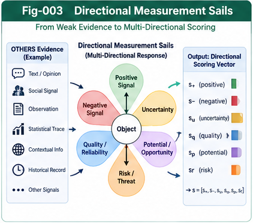

# Figure Index

**Project:** Beyond Matching: OTHERS, Directional Weak-Evidence Scoring, and Reputational Intelligence  
**Version:** 1.0.0  
**Authors:** Sizhe Tan & GPT-Obot  
**Status:** Conceptual research framework; diagrams are illustrative, not experimental results.

## Overview

This index defines the seven canonical figure identifiers, filenames, intended meanings, and recommended insertion points for the eight core papers (BM-001–BM-008). Keep figure identifiers and paths stable across the repository. The original artwork was produced as a seven-panel composite; the seven standalone PNGs listed below must be exported and checked before their relative links will resolve. Do not substitute the composite image under seven different names.

## Canonical Figure Catalog

| Figure | Canonical file | Purpose | Primary placement |
|---|---|---|---|
| Fig-001 | `figures/Fig-001-Beyond-Matching-Grand-Map.png` | Project-wide relationship between formal matching, OTHERS, directional scoring, perspective, structural growth, and governance | `README.md`; `docs/BM-002-OTHERS-as-an-Open-Evidence-Space.md` |
| Fig-002 | `figures/Fig-002-Matching-vs-Perspective-Distance.png` | Contrast feature similarity and perspective-dependent, potentially asymmetric assessment | `docs/BM-001-Beyond-Matching-and-the-Limits-of-Distance-Scoring.md` |
| Fig-003 | `figures/Fig-003-Directional-Measurement-Sails.png` | Directional responses of heterogeneous weak-evidence signals; sail orientations, weights, and uncertainty | `docs/BM-003-Directional-Measurement-Sails-and-Weak-Evidence-Scoring.md` |
| Fig-004 | `figures/Fig-004-Reputational-Collective-Signals.png` | Collective signal flow, provenance, correlation, and independent corroboration | `docs/BM-004-Reputational-Intelligence-and-Collective-Weak-Signals.md` |
| Fig-005 | `figures/Fig-005-OTHERS-Structural-Growth-Loop.png` | Capture → Sense → Propose → Challenge → Promote → Reassess; residual OTHERS remain open | `docs/BM-006-From-OTHERS-to-Open-Structural-Scoring-Growth.md` |
| Fig-006 | `figures/Fig-006-Evidence-Perspective-Decision-Planes.png` | Separation of evidence, perspective interpretation, action choice, and governance | `docs/BM-005-Perspective-Distance-and-Competitive-Action-Scoring.md`; `docs/BM-007-Counter-Evidence-Provenance-and-Scoring-Governance.md` |
| Fig-007 | `figures/Fig-007-Unified-Open-Scoring-Architecture.png` | End-to-end reference architecture and validation interfaces | `docs/BM-008-Unified-Architecture-Research-Agenda-and-Validation.md` |

## Recommended Insertion Locations

Insertion points are *semantic anchors*, not guaranteed section numbers: section numbering may change during editing.

### Fig-001 — Beyond Matching Grand Map

- **Primary:** BM-002, immediately after the introduction of OTHERS as an open evidence space (approximately after Section 3).
- **Secondary:** README, after the project vision and before the paper navigation.
- **Caption:** *Fig-001. Beyond Matching grand map: formal features and residual evidence feed directional assessment, structural learning, and governed choice. Conceptual architecture.*

### Fig-002 — Matching vs Perspective Distance

- **Primary:** BM-001, after the distinction between matching, metric distance, perspective distance, and action scoring (approximately after Section 3).
- **Caption:** *Fig-002. Matching-based similarity is distinct from perspective-dependent assessment and action cost; the latter need not satisfy metric axioms.*

### Fig-003 — Directional Measurement Sails

- **Primary:** BM-003, immediately after the directional response model (approximately after Section 3).
- **Caption:** *Fig-003. Directional measurement sails aggregate heterogeneous signals across several evaluation directions while preserving reliability and uncertainty.*

### Fig-004 — Reputational Collective Signals

- **Primary:** BM-004, after the explanation of reputation propagation and source dependence (approximately after Section 6).
- **Caption:** *Fig-004. Collective weak-signal transmission: repeated messages are not necessarily independent evidence, and provenance constrains aggregation.*

### Fig-005 — OTHERS Structural Growth Loop

- **Primary:** BM-006, after the six-stage structural growth loop (approximately after Section 3).
- **Secondary:** BM-002, after the discussion of evidence promotion and residual OTHERS (approximately after Section 7).
- **Caption:** *Fig-005. OTHERS-to-structure loop: provisional directional effects are challenged and validated before promotion into explicit features, metrics, CCCs, or principles.*

### Fig-006 — Evidence, Perspective, and Decision Planes

- **Primary:** BM-005, after the three-plane architecture (approximately after Section 5).
- **Secondary:** BM-007, after the governance boundaries (approximately after Section 3).
- **Caption:** *Fig-006. Evidence, perspective, and decision planes retain distinct responsibilities; authorization and counter-evidence apply across their interfaces.*

### Fig-007 — Unified Open Scoring Architecture

- **Primary:** BM-008, immediately after the unified architecture description (approximately after Section 3).
- **Caption:** *Fig-007. Unified open-scoring reference architecture connecting evidence ingestion, directional evaluation, perspective, governed action, validation, and structural growth.*

## Markdown Embedding Examples

Paths in a root-level file such as `README.md`:

```markdown

```

Paths in a paper under `docs/`:

```markdown

```

Keep the figure caption directly below the image in the relevant paper. Avoid embedding the same figure twice in a single paper unless there is a clear explanatory reason.

## Production and Release Checklist

- [ ] Export the original seven-panel artwork as **seven independent PNG files**.
- [ ] Inspect each export for legible labels, correct panel identity, complete edges, and absence of accidental cropping.
- [ ] Compare the actual visual content against the canonical figure title; revise any mismatches.
- [ ] Save the PNGs under `figures/` using the exact canonical filenames above.
- [ ] Embed the figures using `../figures/` in `docs/` and `figures/` at repository root.
- [ ] Verify captions, numbering, accessibility alt text, and all relative links on GitHub.
- [ ] Confirm diagrams do not imply measured results, proven causality, or validated superiority where none has been established.
- [ ] Record any revised artwork or figure mapping in `CHANGELOG.md` before release.

## Interpretation and Research Integrity

These figures are *proposed mechanisms and research architecture*, not empirical evidence. Directional weak-evidence scoring, reputation aggregation, and open structural growth require independent validation. In particular, avoid conflating a mathematical metric with perspective-dependent cost, social popularity with independent corroboration, or an unverified signal with an established principle.

## Related Documents

- [README](README.md)
- [START-HERE](START-HERE.md)
- [CONTENTS](CONTENTS.md)
- [GLOSSARY](GLOSSARY.md)
- [Future Directions](FUTURE-DIRECTIONS.md)

---

**Citation:** Sizhe Tan & GPT-Obot. *Beyond Matching: OTHERS, Directional Weak-Evidence Scoring, and Reputational Intelligence*, v1.0.0. DOI to be assigned upon release.

