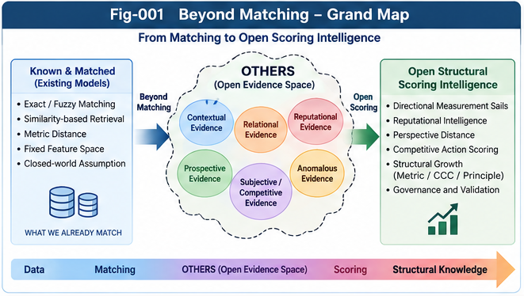

# Beyond Matching: OTHERS, Directional Weak-Evidence Scoring, and Reputational Intelligence

**An open research framework for evaluating what cannot yet be formally matched.**

**Authors:** Sizhe Tan & GPT-Obot  
**Version:** v1.1.0 (research foundation)  
**License:** Apache-2.0  
**Status:** Conceptual and algorithmic proposals; empirical claims remain to be validated.

---

# v1.1.0 Extentions to v1.0.0

### Metric-Directional Intuition (MDI)

**A research extension of Beyond Matching: OTHERS, Directional Weak-Evidence Scoring, and Reputational Intelligence (BM-ODWEI)**

[v1.1.0 metric-directional-intuition](extensions/metric-directional-intuition)

---

# v1.0.0 Contents




*Fig-001. Beyond Matching grand map: formal features and residual evidence feed directional assessment, structural learning, and governed choice. Conceptual architecture.*

---

> Not everything that matters can initially be matched. Intelligence must be able to evaluate directional evidence beyond formal matching, learn from its consequences, and progressively transform useful residual signals into explicit structural knowledge.

## 1. Why Beyond Matching?

Conventional similarity and distance systems excel when objects can be represented in a shared, stable feature space. Open-world decisions often involve contextual, relational, reputational, prospective, anomalous, and subject-dependent evidence that cannot yet be aligned to predefined metrics. We call this residual, evolving evidence space **OTHERS**.

The project investigates four distinct questions:

1. **Matching:** How similar are two objects under a specified feature representation?
2. **Perspective distance:** Which differences matter from a particular perspective and context?
3. **Weak-evidence scoring:** How should heterogeneous, partially verified signals affect directional assessments?
4. **Action choice:** Given evidence, goals, consequences, and authorization, what should an agent do?

These are related but not interchangeable. In particular, `distance = 1 - similarity` can define a dissimilarity transformation for a normalized score, but it does not generally guarantee a metric or encode asymmetric action costs.

## 2. Core Research Contributions (Proposed)

- **OTHERS as an Open Evidence Space:** a revisable interface for signals not captured by the current matched representation, rather than a license to accept arbitrary claims.
- **Directional Measurement Sails (DMS):** a metaphor and candidate computational mechanism for measuring how weak signals affect distinct evaluation directions.
- **Reputational and Collective Weak Signals:** source-aware aggregation of indirect observations, with controls for copying, dependence, and coordinated manipulation.
- **Perspective / Decision Separation:** evidence assessment, contextual interpretation, and goal-dependent action selection remain separate, auditable planes.
- **Open Structural Scoring Growth (OSSG):** validated residual signals can be promoted into features, metrics, cross-domain concepts (CCC), or principles; unresolved evidence remains contestable.
- **Governance by Design:** counter-evidence, provenance, uncertainty, promotion gates, and authority boundaries constrain scoring and action.

These are **research proposals**, not established performance improvements or claims of priority over earlier work.

## 3. A Minimal Mathematical Sketch

Let objects be `x` and `y`, perspective `P`, and context `C`:

```text
S(x, y | P, C) = F(E_matched, M_matched, OTHERS; P, C)
```

A candidate directional response for sail `k` is:

```text
R_k(x) = sum_i w_i * q_i * g(v_i, u_k)
```

Here `w_i` denotes a signal weight, `q_i` its assessed quality, `v_i` a signal representation, `u_k` an evaluation direction, and `g` a response function. The sum is a starting baseline: correlated evidence, missingness, uncertainty, and calibration require explicit treatment.

Action choice is a distinct downstream operation:

```text
a* = argmax_a E[U(a, world_state) | evidence, perspective, context, goal]
```

Evidence must not be rewritten merely to make a preferred action appear justified.

## 4. Architecture at a Glance

```text
World / Human / Social / Historical / Anomalous Signals
                         |
                         v
          Evidence Ingestion + Provenance
                         |
                         v
      Matched Features + OTHERS Processing
                         |
                         v
          Directional Measurement Sails
                         |
              +----------+----------+
              |                     |
              v                     v
    Reputation / Collective    Counter-Evidence
       Signal Assessment       and Calibration
              |                     |
              +----------+----------+
                         |
                         v
              Perspective Interpretation
                         |
                         v
          Governed Action / SSI Choice
                         |
                         v
          Feedback + Structural Growth
                         |
              New Features / Metrics /
                 CCC / Principles
```

The **Evidence**, **Perspective**, and **Decision** planes are deliberately separated. Policy and governance apply across the pipeline.

## 5. The OTHERS-to-Structure Loop

**Capture → Sense → Propose → Challenge → Promote → Reassess**

1. Capture weak or previously unmodeled signals with provenance.
2. Sense directional effects without treating them as established facts.
3. Propose candidate features, relations, sails, or structural principles.
4. Challenge them with counter-evidence and out-of-distribution tests.
5. Promote only sufficiently validated candidates into explicit structure.
6. Reassess performance, uncertainty, drift, and possible rollback.

An important open question is whether a system can **discover new scoring directions**, not merely tune weights for predefined ones.

## 6. Research Papers

| Paper | Focus |
|---|---|
| [BM-001 — Beyond Matching and the Limits of Distance Scoring](docs/BM-001-Beyond-Matching-and-the-Limits-of-Distance-Scoring.md) | Matching, distance, and cross-domain limitations |
| [BM-002 — OTHERS as an Open Evidence Space](docs/BM-002-OTHERS-as-an-Open-Evidence-Space.md) | Evidence taxonomy and open interfaces |
| [BM-003 — Directional Measurement Sails and Weak-Evidence Scoring](docs/BM-003-Directional-Measurement-Sails-and-Weak-Evidence-Scoring.md) | Candidate directional scoring algorithm |
| [BM-004 — Reputational Intelligence and Collective Weak Signals](docs/BM-004-Reputational-Intelligence-and-Collective-Weak-Signals.md) | Social, indirect, and collective signals |
| [BM-005 — Perspective Distance and Competitive Action Scoring](docs/BM-005-Perspective-Distance-and-Competitive-Action-Scoring.md) | Perspective, utility, competition, SSI |
| [BM-006 — From OTHERS to Open Structural Scoring Growth](docs/BM-006-From-OTHERS-to-Open-Structural-Scoring-Growth.md) | Candidate-to-validated-structure lifecycle |
| [BM-007 — Counter-Evidence, Provenance, and Scoring Governance](docs/BM-007-Counter-Evidence-Provenance-and-Scoring-Governance.md) | Integrity, adversarial risks, authority |
| [BM-008 — Unified Architecture, Research Agenda, and Validation](docs/BM-008-Unified-Architecture-Research-Agenda-and-Validation.md) | Synthesis, hypotheses, experiments |

For a guided reading path, see [START-HERE.md](START-HERE.md) and [CONTENTS.md](CONTENTS.md) when available.

## 7. Figures

The v1.0.0 figure plan includes:

| Figure | Subject |
|---|---|
| Fig-001 | Beyond Matching Grand Map |
| Fig-002 | Matching vs Perspective Distance |
| Fig-003 | Directional Measurement Sails |
| Fig-004 | Reputational and Collective Signals |
| Fig-005 | OTHERS Structural Growth Loop |
| Fig-006 | Evidence, Perspective, and Decision Planes |
| Fig-007 | Unified Open Scoring Architecture |

Expected image paths follow `figures/Fig-001-Beyond-Matching-Grand-Map.png` through `figures/Fig-007-Unified-Open-Scoring-Architecture.png`. The seven illustrations should be exported as **individual PNG files** before embedding them here; a composite poster is not a substitute for those files.

## 8. Validation Before Claims

The framework should be tested against matched-feature, context-aware, multi-criteria, reputation-aware, and learned-ranking baselines. Core outcomes include:

- Cross-domain ranking and prediction quality, including out-of-distribution performance.
- Probability calibration, abstention, and uncertainty quality.
- Robustness to rumor duplication, correlated sources, and adversarial reputation manipulation.
- Incremental value of directional weak evidence in ablation studies.
- Decision utility under asymmetric risk, with evidence quality evaluated separately.
- Whether promoted features or newly discovered sails generalize beyond their discovery setting.

A positive result in one task does not establish a universal improvement in distance scoring.

## 9. Intellectual Context and Boundaries

The project draws motivation from established work in multi-criteria decision analysis (including outranking methods), strategic weak signals, social networks and reputation, Bayesian evidence aggregation, preference learning, decision theory, and robust AI evaluation. Its proposed contribution lies in **connecting** open residual evidence, directional scoring, counter-evidence, structural promotion, and governed subjective choice into a unified architecture. Novelty and empirical superiority remain research questions.

This project also interfaces with the broader Structural Intelligence (SI) research program: Metric Differential Trees (MDT), Cross-Domain Concepts (CCC), Principle Intelligence, PIRP/PIRU, Collective Structural Learning, and Subjective Structural Intelligence (SSI). Those interfaces are architectural proposals, not demonstrated interoperability.

## 10. Roadmap

**v1.0.0 — Foundation:** conceptual definitions, candidate algorithms, governance contracts, research agenda, and figures.  
**v1.1.0 — Controlled validation:** baselines, synthetic and real-world test sets, ablations, robustness and calibration studies.  
**v2.0.0 — Structural integration:** dynamic sail discovery, feature promotion, cross-node learning, and policy-governed runtime prototypes.

See [FUTURE-DIRECTIONS.md](FUTURE-DIRECTIONS.md) when available.

## 11. Reading, Citation, and License

Start with **BM-001**, then **BM-002** and **BM-003** for the core hypothesis and mechanism. Read **BM-004** through **BM-007** for social evidence, action, growth, and governance; **BM-008** integrates the research program.

**Authors:** Sizhe Tan & GPT-Obot. Please use [CITATION.cff](CITATION.cff) once the release metadata and DOI are finalized. Do not cite a DOI until it has been assigned.

Licensed under **Apache License 2.0**; see [LICENSE.txt](LICENSE.txt).

---

## Authors

**Sizhe Tan & GPT-Obot**

DOI: 10.5281/zenodo.23786497

---

## 📚 DBM-SI Series Navigation

See:\
[./docs/DBM-SI-Series-of-gitHub-Repositories/DBM-SI-Series-of-gitHub-Repositories.md](./docs/DBM-SI-Series-of-gitHub-Repositories/DBM-SI-Series-of-gitHub-Repositories.md)

---

**Guiding principle:** *Beyond matching is not beyond evidence. Weak signals may guide inquiry, but only validated evidence should acquire structural authority.*

