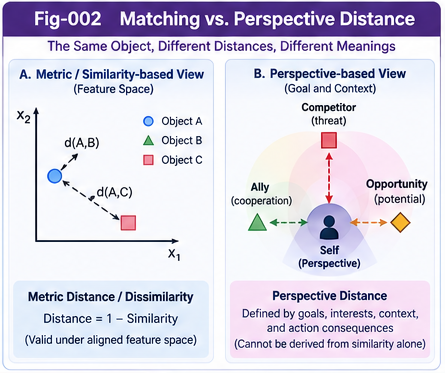

# BM-001 — Beyond Matching and the Limits of Distance Scoring

**Project:** Beyond Matching: OTHERS, Directional Weak-Evidence Scoring, and Reputational Intelligence  
**Authors:** Sizhe Tan & GPT-Obot  
**Version:** 1.0.0 (Foundational Research Draft)  
**Date:** 2026-10-16  
**Status:** Conceptual framework and testable research agenda; no empirical performance claims

## Abstract

Distance and similarity are foundational tools for search, classification, retrieval, clustering, recommendation, and intelligent decision-making. Yet a score computed from aligned features does not necessarily capture the relationship that matters to an agent acting under uncertainty. In open-world and cross-domain settings, relevant evidence may be contextual, relational, reputational, prospective, or only partially formalized. This paper distinguishes **feature matching**, **mathematical metric distance**, **perspective-dependent relational distance**, and **action-oriented evaluation**. It introduces **OTHERS** as an explicit, open evidence interface for signals not adequately represented by a current matching model. It also clarifies the mathematical limits of the common transformation `distance = 1 − similarity`, proposes a layered scoring architecture, and states falsifiable hypotheses for subsequent research. The central claim is architectural rather than empirical: intelligent evaluation should not silently equate what can currently be matched with everything that matters.

**Keywords:** distance scoring; cross-domain evaluation; similarity; OTHERS; weak evidence; perspective distance; subjective structural intelligence; open-world intelligence; structural growth

---

---

## 1. The Problem: When Matching Is Not Enough

Many computational systems evaluate two objects by first mapping them into a shared representation and then computing a score. This works well when the representation captures the dimensions relevant to the task. It becomes less reliable when the task requires relations outside that representation.

Consider a wildlife observer assessing an unfamiliar animal. Visual resemblance may be weak evidence about danger; movement, nearby animals' reactions, environmental conditions, and possible consequences of a mistaken judgment may be more important. These signals need not all be comparable in one Euclidean space. The relevant question is not only *How similar are these objects?* but also *What does this situation mean for this observer and the action now available?*

This paper does **not** assume that AI systems are universally inferior to humans in cross-domain judgment. Performance varies by model, task, available evidence, and evaluation protocol. Instead, it isolates a plausible failure mode: a scoring architecture may discard consequential signals because they cannot be expressed as strictly matched components.

### Research question

> How can an intelligent system evaluate consequential relationships when part of the relevant evidence is not yet formally matched, measured, or structurally represented?

## 2. Four Objects That Must Not Be Confused

### 2.1 Matching score

A matching score describes agreement or resemblance within a chosen feature representation:

$$
S_{\mathrm{match}}(x,y\mid\phi,C)=s\bigl(\phi_C(x),\phi_C(y)\bigr).
$$

Here $\phi_C$ is the feature representation chosen for context $C$. The score is only as adequate as that representation and the scoring function $s$.

### 2.2 Metric distance

A mathematical metric $d:X\times X\rightarrow\mathbb{R}_{\geq 0}$ satisfies non-negativity, identity of indiscernibles, symmetry, and the triangle inequality. Euclidean distance is one example. These properties support powerful indexing, geometric reasoning, and optimization, but they are not requirements for every intelligent comparison.

### 2.3 Perspective-dependent distance

A perspective-dependent comparison expresses relational separation with respect to a viewpoint and context:

$$
D_P(x,y\mid C)=F_P\bigl(E(x,y),M(x,y),O(x,y,C);C\bigr).
$$

$E$ denotes aligned Euclidean components; $M$ denotes other matched or measured components; $O$ denotes relevant residual evidence. This is a **general scoring functional**, not automatically a metric. It may be asymmetric, task-dependent, and time-varying. The notation does not imply that all components are numerically commensurable or simply additive.

### 2.4 Action-oriented evaluation

Action evaluation asks what a choice means for an agent's goals and consequences:

$$
Q(a\mid P,C,G,\mathcal E)=\mathbb E\left[U(a,\omega;P,G)\mid C,\mathcal E\right],
$$

where $P$ identifies the decision-making perspective, $G$ its goals, $\mathcal E$ the available evidence, and $\omega$ an uncertain world state. This expression assumes a probabilistic utility model; other robust or non-probabilistic decision rules may be appropriate.

**Key distinction:** matching is descriptive; perspective distance is relational; action scoring is selective. The latter two may consume matching scores without being reducible to them.

## 3. What `1 − Similarity` Does—and Does Not—Mean

A common engineering transformation is

$$
D(x,y)=1-S(x,y), \qquad S(x,y)\in[0,1].
$$

This is a legitimate *definition of dissimilarity* for a bounded similarity score, not necessarily an approximation. But it does **not** generally establish a mathematical metric: the resulting function may violate the triangle inequality, identity of indiscernibles, or symmetry (if the original similarity is asymmetric).

More importantly, the transformation cannot recover information omitted by $S$. If the similarity score excludes indirect danger, social signals, strategic cost, or the agent's goals, subtracting it from one does not make those factors appear.

A directional transition cost may also satisfy

$$
C(x\rightarrow y)\neq C(y\rightarrow x),
$$

without being mathematically defective. The asymmetry can reflect different costs, constraints, or consequences. We should therefore use precise names—*metric distance*, *dissimilarity*, *perspective score*, or *action cost*—instead of calling every scalar comparison a distance.

*Fig-002. Matching-based similarity is distinct from perspective-dependent assessment and action cost; the latter need not satisfy metric axioms.*

---

## 4. OTHERS: An Explicit Open Evidence Interface

We propose **OTHERS** as a name for evidence that may matter to a judgment but is not adequately captured by the current aligned-feature scoring model.

A provisional decomposition is:

| Component | Representative content | Main risk |
|---|---|---|
| Contextual | timing, environment, hidden conditions | context leakage or omission |
| Relational | social, functional, causal, network relationships | spurious associations |
| Reputational | reported experience, collective assessments | echo chambers and manipulation |
| Prospective | trajectories, leading indicators, future contingencies | speculative overreach |
| Subject-dependent | goals, risk tolerance, constraints, competitive position | confusing preferences with facts |
| Residual / unknown | signals not yet classified | noise, unverifiable claims |

These are **working categories**, not an exhaustive or mutually exclusive ontology. In particular, subject-dependent *preferences* should remain distinct from evidence *about the world*.

A useful conceptual separation is

$$
O=O_{\mathrm{world}}\oplus O_{\mathrm{subject}},
$$

where $\oplus$ means structured composition rather than arithmetic addition. An implementation should retain provenance, uncertainty, and applicable context for each signal.

**Open does not mean uncritical:** the system must be able to admit candidate signals without promoting unsupported claims into verified facts.

## 5. Why Cross-Domain Evaluation Is Difficult

Four separable failure modes deserve testing:

1. **Feature alignment failure.** Two domains do not share a sufficiently expressive coordinate system.
2. **Latent relation loss.** Functional, causal, or behavioral equivalence is missed by surface matching.
3. **Perspective mismatch.** The scoring objective differs from the evaluator's actual task or goals.
4. **Weak-evidence exclusion.** Contextual or indirect signals are discarded because they lack a strict matching representation.

The OTHERS interface principally targets the fourth problem and may help with the second and third. It does not by itself solve representation learning, causal identification, or preference alignment.

A rigorous evaluation must distinguish whether the model (a) lacked a signal, (b) represented it but failed to use it, or (c) optimized a different objective. These causes demand different remedies.

## 6. From Residual Signals to Directional Scoring

An unstructured signal can still have a directional effect on an evaluation. For example, a report that a company frequently takes risks might increase an *innovation* score while reducing a *capital-preservation* score. Neither effect is a universal fact about the company's overall quality.

We therefore propose an interface between OTHERS and a future **Directional Weak-Evidence Scoring** mechanism:

$$
\mathbf R(x\mid C)=\left[R_1(x\mid C),\ldots,R_K(x\mid C)\right].
$$

Each $R_k$ is a response along an explicitly defined or learned evaluative direction. Candidate signals should retain their source, dependence structure, uncertainty, and evidence status. The detailed **Directional Measurement Sails** algorithm belongs to **BM-003**, rather than being prematurely specified here.

A crucial distinction is between *observed directional association* and *verified causal effect*. A sail's response is initially a score, not proof of causation.

## 7. Evidence, Perspective, and Decision: A Three-Plane Architecture

We recommend three interfaces:

**Evidence Scoring Plane.** Ingest matched metrics and OTHERS; track provenance, reliability, uncertainty, and counter-evidence. Produce auditable descriptive outputs.

**Perspective Interpretation Plane.** Evaluate evidence relative to a declared perspective, task, and context. Produce perspective-dependent comparisons without silently changing the underlying evidence.

**Decision Plane.** Apply goals, utilities, constraints, risk tolerances, and policy rules to choose or recommend actions. The decision layer must not rewrite factual evidence to make a preferred choice appear objectively true.

This separation connects the present project to **Subjective Structural Intelligence (SSI)** while keeping its research object distinct: the present work asks *what can be scored beyond formal matching*; SSI asks *whose perspective, authority, and choice govern the result*.

## 8. OTHERS as a Structural Growth Frontier

OTHERS should not be a permanent dumping ground. Repeated directional effects can suggest candidate features, relations, or principles that deserve formal validation:

$$
O_t\xrightarrow{\mathrm{directional\ scoring}}H_t
\xrightarrow{\mathrm{testing\ and\ validation}}K_{t+1}.
$$

$H_t$ represents candidate explanatory structures; $K_{t+1}$ represents validated knowledge. Unexplained or unvalidated signals remain in the residual evidence space $O_{t+1}$.

The resulting research loop is:

1. Detect consequential but poorly matched signals.
2. Preserve their provenance and context.
3. Estimate directional predictive value.
4. Form candidate features or structural hypotheses.
5. Test against counter-evidence and distribution shift.
6. Promote validated structures into explicit metrics, CCCs, or principles where justified.
7. Retain residual uncertainty and continue monitoring.

This is a proposed **open-ended scoring growth** pathway, not evidence that all residual signals can eventually be formalized.

## 9. Scientific Boundaries and Prior Work

The general idea of incorporating soft, indirect, or non-compensatory evidence into decisions is not new. Relevant traditions include multi-criteria decision analysis (notably ELECTRE and PROMETHEE), strategic weak-signal analysis, bounded rationality, prospect theory, reputation systems, and social-network information diffusion.

The potential contribution of this project lies in **integration and explicit interfaces**: an open residual evidence space; direction-specific evaluation; provenance and counter-evidence controls; and a route from weak signals to validated structural representations. Novelty must be assessed against these existing traditions, not presumed from terminology.

We also distinguish historical analogy from empirical proof. Human practices such as divination and ritual may illustrate attempts to make decisions under uncertainty, but their existence does not validate a predictive scoring algorithm.

## 10. Falsifiable Research Hypotheses

**H1 — Incremental predictive value.** On specified cross-domain tasks, relevant and independently sourced weak evidence improves predictive performance over a matched-feature baseline.

**H2 — Directionality.** A vector of perspective-specific evidence responses outperforms a single undifferentiated reputation scalar on tasks with conflicting evaluation criteria.

**H3 — Structural growth.** Validated candidate features derived from residual signals improve out-of-distribution performance or calibration compared with leaving those signals unstructured.

**H4 — Governance.** Provenance tracking, dependence correction, and counter-evidence reduce susceptibility to coordinated reputation manipulation and repeated-source amplification.

**H5 — Decision separation.** Keeping descriptive evidence separate from utility-based action selection improves auditability and reduces preference-induced distortion without necessarily sacrificing decision quality.

Each hypothesis may fail. Negative results should be recorded rather than reclassified as success.

## 11. Validation Blueprint

Compare at least four configurations on identical evidence budgets:

| System | Components |
|---|---|
| A | matched features only |
| B | matched features plus explicit context |
| C | B plus directional weak-evidence scoring |
| D | C plus declared perspective and goal-aware decision rules |

Evaluate predictive accuracy, ranking quality, calibration, robustness to distribution shift, provenance sensitivity, resistance to correlated false reports, and risk-adjusted action utility. Use ablations that remove OTHERS categories, directionality, and provenance controls independently.

Datasets must distinguish **ground truth** from **social consensus**. In particular, reputation signals should never be treated as the target label merely because they are widespread. Pre-register task definitions and scoring rules when feasible.

## 12. Interfaces to the Wider Structural Intelligence Research Program

- **MDT / Differential Structures:** organize candidate residual signals and evolving feature partitions.
- **CCC / Principle Intelligence:** represent validated, reusable patterns extracted from repeated evidence.
- **Two-Way CCC / Counter-Evidence:** test candidate structures against contradictory observations.
- **PIRP / PIRU / Collective Structural Learning:** exchange context-bound weak-signal structures across agents without collapsing source independence.
- **Policy Control Plane:** constrain which evidence can influence consequential decisions and how.
- **SSI:** maintain explicit boundaries between evidence, perspective, preference, and decision authority.

These are architectural integration opportunities, not implemented interoperability claims.

## 13. Scope and Limitations

This v1.0.0 paper presents a research framework. It does not supply a trained model, implementation, benchmark result, or proof of superiority over established decision methods. The OTHERS categories are provisional; the exact directional response algorithm remains to be specified in BM-003. The framework must avoid rewarding rumor, laundering bias through mathematical notation, and confusing strategic usefulness with factual truth.

## 14. Conclusion

Formal matching remains indispensable, but it should not define the outer boundary of intelligent evaluation. A system may need to reason about contextual, relational, reputational, prospective, and other partially formalized evidence before those signals can be expressed as stable matched features. We propose **OTHERS** as an auditable open interface for this residual evidence and distinguish descriptive matching, perspective-dependent comparison, and action-oriented choice. The broader research opportunity is to transform useful weak evidence into progressively validated structural knowledge while preserving uncertainty and governance.

> **Not everything that matters can initially be matched; what cannot yet be matched may still be directionally sensed, evaluated, tested, and eventually structured.**

## 15. Reading and Research References

The following are foundational starting points, not a claim of exhaustive literature coverage:

1. Ansoff, H. I. (1975). *Managing Strategic Surprise by Response to Weak Signals*. California Management Review, 18(2), 21–33.
2. Granovetter, M. S. (1973). *The Strength of Weak Ties*. American Journal of Sociology, 78(6), 1360–1380.
3. Simon, H. A. (1955). *A Behavioral Model of Rational Choice*. Quarterly Journal of Economics, 69(1), 99–118.
4. Kahneman, D., & Tversky, A. (1979). *Prospect Theory: An Analysis of Decision under Risk*. Econometrica, 47(2), 263–291.
5. Roy, B. (1991). *The Outranking Approach and the Foundations of ELECTRE Methods*. Theory and Decision, 31, 49–73.
6. Brans, J.-P., & Vincke, P. (1985). *A Preference Ranking Organisation Method: The PROMETHEE Method for Multiple Criteria Decision-Making*. Management Science, 31(6), 647–656.

## 16. Figure Placement

**Suggested insertion:** `figures/Fig-002-Matching-vs-Perspective-Distance.png` immediately after Section 3, illustrating the distinction among feature matching, perspective-dependent comparison, and directional action costs.

**Optional cross-reference:** `figures/Fig-001-Beyond-Matching-Grand-Map.png` in the repository README and BM-008. Do not duplicate the Grand Map here unless it adds explanatory value.

---

**Next in the series:** [BM-002 — OTHERS as an Open Evidence Space](BM-002-OTHERS-as-an-Open-Evidence-Space.md)

**Citation note:** Cite the archived DOI release once available. No DOI is asserted in this draft.
