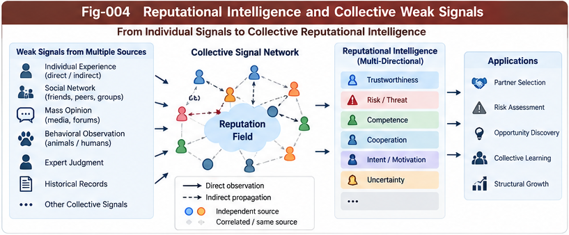

# BM-004 — Reputational Intelligence and Collective Weak Signals

**Project:** Beyond Matching: OTHERS, Directional Weak-Evidence Scoring, and Reputational Intelligence  
**Authors:** Sizhe Tan & GPT-Obot  
**Version:** 1.0.0 — Research Framework  
**Status:** Conceptual and algorithmic proposal; not an empirical validation  
**Date:** 2026-10-16

## Abstract

A substantial share of useful judgment is mediated by signals that do not constitute direct, fully matched measurements of a target. Animals react to the behavior of conspecifics; humans exchange informal assessments of people, organizations, risks, and opportunities; and distributed intelligent systems may share partial observations before they possess a common feature schema. We call one important subset of this activity **Reputational Intelligence (RI)**: the acquisition, interpretation, and revision of direction-specific assessments from socially or collectively transmitted evidence. RI is a subset of the broader **Directional Weak-Evidence Intelligence** proposed in this repository. This paper specifies how collective weak signals can be represented, propagated, aggregated, audited, and converted into candidates for structural learning. It separates reputation from truth, information propagation from independent corroboration, and descriptive evidence from subjective action policy. A directional reputation field, provenance-aware aggregation, uncertainty-aware abstention, and a counter-evidence loop provide a candidate architecture for integration with Structural Intelligence (SI), Collective Structural Learning (CSL), PIRP/PIRU, and Subjective Structural Intelligence (SSI). All performance benefits remain hypotheses requiring controlled evaluation.

**Keywords:** reputational intelligence; weak evidence; social signals; collective learning; provenance; directional scoring; trust; counter-evidence; structural intelligence.

---

---

## 1. The Problem: Collective Judgment Before Formal Matching

Classical similarity scoring presumes that relevant features can be extracted, aligned, and compared. In real environments, decision makers frequently encounter assessments such as:

- “This route may be dangerous.”
- “That supplier tends to miss deadlines.”
- “Several independent observers noticed unusual behavior.”
- “Other animals have abruptly stopped feeding.”

Such statements may influence action even when no complete metric or causal explanation is available. They are neither necessarily ground truth nor necessarily worthless noise. The research challenge is to make their evidential role explicit, provisional, and testable.

**Research question:** How can an intelligent system use collectively transmitted, incompletely formalized signals without mistaking popularity, repetition, or social authority for independent evidence?

## 2. Scope and Terminology

### 2.1 Weak evidence

A **weak-evidence item** is a potentially decision-relevant observation or claim whose interpretation, reliability, applicability, or causal connection remains incomplete. Weakness is relative to a task and evidence standard; it is not a declaration of falsity.

### 2.2 Reputational intelligence

**Reputational Intelligence (RI)** denotes the processing of assessments transmitted through social or collective channels about a target's likely properties, conduct, or consequences. It includes the ability to qualify, challenge, and update those assessments.

### 2.3 Collective weak signals

**Collective weak signals** include socially transmitted judgments and indirect behavioral cues. Not all are reputation: observing a flock's sudden departure can be an indirect environmental cue without a stable assessment of any individual's character.

### 2.4 Relation to OTHERS

Let the scoring evidence space be partitioned conceptually into matched components and residual components:

\[
\mathcal E_t = \mathcal E_{\mathrm{matched},t}\ \cup\ \mathcal O_t.
\]

The partition depends on the current schema and context; it need not be disjoint in a literal data-storage implementation. Reputational evidence may initially reside in \(\mathcal O_t\), then become formally represented as reliable predictors after validation.

**Important boundary:** RI is one source within OTHERS, not a synonym for all OTHERS.

## 3. Historical and Interdisciplinary Foundations

This research direction has important predecessors. Social-network research investigates how information and influence traverse interpersonal connections; studies of reputation and trust examine how agents evaluate others under incomplete information; management science analyzes soft information and early warning signals; decision analysis studies preferences under multiple imperfect criteria. The present proposal does **not** claim to originate social reputation, weak signals, indirect learning, or evidence aggregation.

Relevant intellectual anchors include:

1. Granovetter's analysis of the strength of weak ties, which concerns network bridges and information transmission rather than a ready-made reputation-scoring algorithm.
2. Ansoff's strategic weak-signals work, which explores early responses to incomplete indications of change.
3. Bayesian evidence updating and probabilistic graphical models, which clarify dependence and uncertainty.
4. Trust and reputation systems in multi-agent settings, which model recommendations, credibility, and adversarial manipulation.
5. Multi-criteria decision analysis, which supports judgments that need not collapse to a single geometric metric.

The distinctive *research proposal* here is an open interface between heterogeneous directional weak signals and structural growth, with explicit provenance and subjective-decision boundaries. Whether this combination is novel in any formal sense requires a systematic literature review.

## 4. From Social Signals to Directional Reputation Fields

A scalar reputation such as “good” or “bad” loses important structure. The same organization may be highly innovative, operationally risky, and trustworthy in a particular contractual setting.

Define a set of scoring directions:

\[
\mathcal U_t = \{u_1,\ldots,u_K\},
\]

such as safety, reliability, innovation, opportunity, or trustworthiness. These are **evaluation directions**, not necessarily Euclidean axes.

For target \(x\), context \(c\), and time \(t\), define a provisional directional field:

\[
\mathbf R(x\mid c,t) = [R_1(x\mid c,t),\ldots,R_K(x\mid c,t)].
\]

Each component is accompanied by quality, uncertainty, provenance, and coverage information. A favorable signal on one direction must not automatically increase all others.

### 4.1 The directional measurement sail

Following the companion paper BM-003, a sail is a task-specific response mechanism that maps heterogeneous evidence into a directional effect:

\[
\rho_{ik}=g_\theta(e_i,u_k,c,t),
\]

where \(e_i\) is an evidence item, \(u_k\) is the direction, and \(g_\theta\) may be a rule, learned model, or structured inference function. The response can be positive, negative, near zero, or undefined.

The sail metaphor emphasizes that the same incoming signal can have different effects under different orientations. It does not imply that social evidence is literally a physical force.

## 5. Evidence Units and Provenance

Each reputational evidence unit (REU) should preserve at least:

| Field | Meaning |
|---|---|
| `target_id` | Entity or situation being assessed |
| `claim` | Original observation or reported assertion |
| `direction_id` | Evaluation direction, if identifiable |
| `polarity` | Positive, negative, mixed, or unknown |
| `source_id` | Originating source or protected pseudonymous reference |
| `observation_time` | When the underlying event occurred |
| `report_time` | When the report was transmitted |
| `context` | Conditions under which the claim might apply |
| `lineage` | Known citation, forwarding, or derivation chain |
| `evidence_type` | Direct observation, inference, hearsay, aggregate, etc. |
| `quality_estimate` | Calibrated or provisional evidence-quality assessment |
| `uncertainty` | Confidence interval, distribution, or explicit unknown |
| `challenge_status` | Unchallenged, disputed, corrected, or withdrawn |

**Design requirement:** Preserve the original claim and its transformations. A downstream summary must not silently become a new independent observation.

Privacy, consent, retention limits, and the possibility of reputational harm must be addressed before deploying person-level systems.

## 6. Aggregation Without Double Counting

A naive score is:

\[
R_k^{\mathrm{naive}}(x)=\sum_i w_iq_i\rho_{ik}.
\]

This is useful as an introductory expression, but dangerous when reports share a common source. One rumor copied a thousand times does not become a thousand independent observations.

A more defensible formulation groups reports into inferred provenance clusters \(G_1,\ldots,G_m\):

\[
R_k(x)=\frac{\sum_{j=1}^{m}W_j\,A_k(G_j)}{\sum_{j=1}^{m}W_j+\varepsilon},
\]

where \(A_k(G_j)\) summarizes the directional contribution of cluster \(j\), \(W_j\) is its quality-adjusted weight, and \(\varepsilon>0\) avoids division by zero. This is a *candidate heuristic*, not a universally unbiased estimator.

More rigorous implementations may use explicit dependence graphs, hierarchical Bayesian models, robust estimators, or bounded influence functions. The model should disclose whether dependence is observed, estimated, or unknown.

### 6.1 Distinguish three quantities

- **Signal volume:** How many reports were encountered?
- **Source diversity:** How many materially distinct origin paths are represented?
- **Evidential support:** How strongly do the underlying observations support the claim?

These quantities are correlated in some settings but never interchangeable by definition.

## 7. Temporal Dynamics and Context Transfer

Reputational evidence decays, persists, or changes meaning depending on the phenomenon. A safety incident from yesterday and a performance assessment from ten years ago should not receive identical treatment.

A candidate temporal factor is:

\[
\tau_i(t)=\exp[-\lambda_k(t-t_i)], \qquad t\ge t_i,
\]

with direction-specific decay rate \(\lambda_k\). This exponential is only a baseline; some historical facts should not decay automatically.

Context transfer also needs explicit checks. A reputation for fast delivery in one market may not generalize to another jurisdiction, scale, or supply chain. The system should track **scope**, **domain shift**, and **known counterexamples**, rather than assuming universal applicability.

## 8. Animal Intelligence and Indirect Social Information

Many animals use social cues when deciding whether to feed, flee, approach, or explore. Such behavior motivates the hypothesis that useful indirect directional evaluation can precede formal symbolic measurement.

However, three mechanisms must not be conflated:

1. **Direct perception:** An animal detects a predator's movement or proximity.
2. **Social information use:** An animal responds to another individual's alarm or behavior.
3. **Reputation-like learning:** An animal tracks a particular individual's past reliability or conduct across encounters.

The third requires stronger evidence than the second. It would be incorrect to label every collective alarm response as reputation.

**Evolutionary hypothesis (unverified here):** Under uncertainty, indirect social cues can sometimes supply decision value before an organism can explicitly identify the underlying cause. This is a functional analogy, not proof of a single evolutionary origin for human reputation systems.

## 9. Human Reputation, Culture, and Institutions

Human reputational intelligence operates through language, memory, institutions, and social networks. Informal judgments may help identify risks or opportunities when direct verification is costly. They may also amplify stereotypes, coordinated misinformation, and status-based deference.

Historical practices such as divination and ritual consultation can be examined as cultural responses to uncertainty and collective decision pressure. Their social role should not be confused with validated predictive accuracy. Any comparison with the proposed computational architecture is interpretive rather than evidence of historical algorithmic equivalence.

An important distinction is between **social coordination value** and **epistemic validity**: a practice may organize a group's actions without accurately predicting external events.

## 10. Collective Structural Learning Interface

The proposed learning pathway is:

\[
\text{Local Experience}
\rightarrow \text{Weak Signal Exchange}
\rightarrow \text{Directional Aggregation}
\rightarrow \text{Candidate Pattern}
\rightarrow \text{Validation}
\rightarrow \text{Structural Knowledge}.
\]

This is particularly relevant to a distributed Structural Intelligence ecosystem. A BrainUnit need not transmit an entire internal model to share a useful, qualified observation. A portable signal or hypothesis may be relayed with provenance and localized to the receiving unit's context.

### 10.1 PIRP/PIRU compatibility

- **PIRP:** A flexible portable piece may carry a provisional assessment, explanation, or hypothesis.
- **PIRU:** A more constrained unit may define required fields, schema versions, confidence semantics, and validation contracts.
- **Relay/localization:** The receiving BrainUnit evaluates whether the signal's context and direction apply locally.

No claim is made that these formats already implement the present protocol; the relationship is a proposed interface.

### 10.2 Avoiding premature consensus

A collective system should retain minority counter-evidence and dissenting contexts. Aggregation must not erase the distinction between “most agents believe this” and “the underlying proposition is well supported.”

## 11. From Reputation to New Structural Features

Repeated, predictive weak signals may reveal a previously unnamed structural factor. The proposed growth loop is:

\[
O_t \rightarrow R_t \rightarrow H_t \rightarrow V_t \rightarrow K_{t+1},
\]

where:

- \(O_t\): residual, not-yet-formalized evidence;
- \(R_t\): directional response patterns;
- \(H_t\): candidate structural hypotheses;
- \(V_t\): independent validation and counter-evidence testing;
- \(K_{t+1}\): accepted explicit metrics, CCC patterns, or principles.

The residual OTHERS space remains open after promotion. Validation may reject or demote candidates, and previously accepted structures may need revision after domain shifts.

**Key proposition:** Reputation is not itself a Principle. It can at most help identify hypotheses worth testing.

## 12. Counter-Evidence and Governance

A deployable RI system requires explicit protections against:

- coordinated reputation attacks and synthetic consensus;
- self-reinforcing feedback loops;
- demographic and institutional bias;
- identity confusion and false attribution;
- unverified allegations about individuals;
- hidden source dependence;
- model overconfidence and reward hacking.

Recommended controls include source-lineage audits, adversarial stress tests, challenge and correction workflows, confidence calibration, reversible structural promotion, access control, and privacy-preserving data practices.

**Anti-Goodhart principle:** Optimizing a reputation score can make the score less informative. The system should test outcomes against independent targets rather than reward mere improvement in reputation indicators.

## 13. Boundary With SSI and Competitive Action Scoring

The evidence plane asks what the available signals support. The perspective plane asks how they matter under a given viewpoint. The decision plane chooses an action under goals and costs.

\[
\underbrace{P(\omega\mid E)}_{\text{evidence-informed belief}}
\quad\longrightarrow\quad
\underbrace{\mathbb E[U(a,\omega)\mid E,P,G]}_{\text{subject-dependent action value}}.
\]

A weak but credible warning may justify a precautionary action when the downside risk is severe. That does not justify presenting the warning as a confirmed fact.

The SSI interface should specify whose utility function is applied, who can authorize action, and how contested evidence is surfaced. Reputational scoring should not silently determine ownership of choices.

## 14. Proposed Evaluation Program

### 14.1 Baselines

| Model | Evidence available |
|---|---|
| A | Matched features only |
| B | Matched features plus context |
| C | B plus naive collective weak-signal counts |
| D | B plus provenance-aware directional aggregation |
| E | D plus structural feature discovery and independent validation |

SSI action policies can be compared as a separate factor, rather than entangled with evidence-quality tests.

### 14.2 Tasks

1. Supplier reliability prediction across markets.
2. Early anomaly detection from distributed observer reports.
3. Collective safety warning with correlated and adversarial sources.
4. Cross-domain transfer of reputation-like signals.
5. Discovery of stable predictors from previously residual OTHERS signals.

Use synthetic data first to control ground truth and source dependence, followed by ethically sourced, appropriately licensed real-world datasets.

### 14.3 Metrics

Measure predictive discrimination, calibration, false-positive and false-negative rates, robustness under rumor duplication, performance under distribution shift, abstention quality, source attribution accuracy, and downstream action utility. Record computational and governance costs.

### 14.4 Falsifiable hypotheses

**H1:** Provenance-aware directional aggregation outperforms naive report-count aggregation when reports are correlated.

**H2:** Multidirectional reputation representations improve task-relevant ranking compared with a single scalar reputation under heterogeneous objectives.

**H3:** Explicit counter-evidence reduces overconfidence under coordinated misinformation.

**H4:** Validated structural promotion improves transfer or sample efficiency relative to indefinitely retaining all useful signals as unstructured OTHERS.

**H5:** Separating evidence quality from subjective utility improves auditability without necessarily reducing decision utility.

All five are empirical questions. Negative results should be reported and used to refine or reject the architecture.

## 15. Open Problems

1. How should direction sets be discovered without embedding hidden normative preferences?
2. Can provenance dependence be inferred reliably when source chains are partially hidden?
3. How can a system preserve dissent without giving adversarial claims disproportionate weight?
4. Which reputation-like signals are transferable across domains, and which are intrinsically local?
5. What minimum evidence is sufficient to promote a recurring weak signal into a structural metric?
6. How can privacy, contestability, and correction rights be enforced in distributed deployments?
7. When should a scoring sail abstain rather than manufacture a numerical answer?
8. How can structural growth avoid feedback loops where its own outputs become its training evidence?

## 16. Position in the BM Series

- **BM-001:** Explains the limits of matching-based distance scoring.
- **BM-002:** Defines OTHERS as an open evidence space.
- **BM-003:** Specifies directional measurement sails and weak-evidence scoring.
- **BM-004 (this paper):** Develops reputational and collective weak-signal intelligence.
- **BM-005:** Separates perspective distance from competitive action scoring.
- **BM-006:** Develops open structural scoring growth.
- **BM-007:** Formalizes provenance, counter-evidence, and governance.
- **BM-008:** Unifies the architecture and evaluation agenda.

### Figure placement

Insert **`figures/Fig-004-Reputational-Collective-Signals.png`** after Section 6, illustrating original sources, propagation clusters, directional sails, and independent corroboration. The figure should distinguish a repeated rumor from multiple independent observations.

## 17. Conclusion

Reputational intelligence is neither an alternative to evidence nor a substitute for rigorous measurement. It is a potentially useful way to process indirect, socially transmitted, and incompletely formalized information while preserving uncertainty and provenance. Its strongest architectural role may be as a bridge between local experience and collective structural learning: provisional directional signals can be exchanged before full formalization, tested against counter-evidence, and selectively promoted into explicit knowledge. The central engineering obligation is to prevent collective repetition from masquerading as truth and to keep evidence scoring separate from subjective action choice.

**Core statement:** *Collective signals may guide inquiry before they become formal knowledge; they earn structural authority only through independent validation.*

## Selected References and Research Anchors

The following are foundational starting points rather than an exhaustive systematic review:

1. Granovetter, M. S. (1973). “The Strength of Weak Ties.” *American Journal of Sociology*, 78(6), 1360–1380. https://doi.org/10.1086/225469
2. Ansoff, H. I. (1975). “Managing Strategic Surprise by Response to Weak Signals.” *California Management Review*, 18(2), 21–33. https://doi.org/10.2307/41164635
3. Jøsang, A., Ismail, R., & Boyd, C. (2007). “A Survey of Trust and Reputation Systems for Online Service Provision.” *Decision Support Systems*, 43(2), 618–644. https://doi.org/10.1016/j.dss.2005.05.019
4. Banerjee, A. V. (1992). “A Simple Model of Herd Behavior.” *Quarterly Journal of Economics*, 107(3), 797–817. https://doi.org/10.2307/2118364
5. Bikhchandani, S., Hirshleifer, D., & Welch, I. (1992). “A Theory of Fads, Fashion, Custom, and Cultural Change as Informational Cascades.” *Journal of Political Economy*, 100(5), 992–1026. https://doi.org/10.1086/261849

---

*Research note: The proposed architecture is a hypothesis-generating framework. It does not establish that all reputation signals are reliable, that animals use the specified computation, or that the proposed model outperforms established decision and trust systems.*
