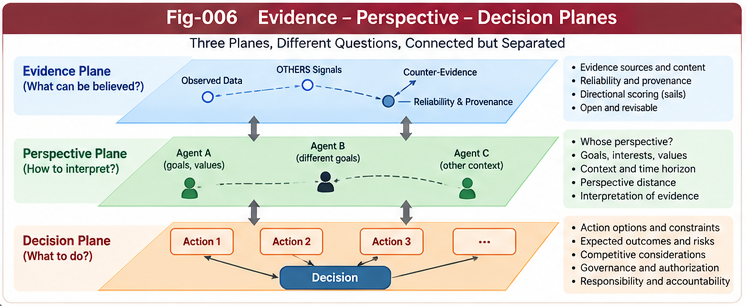

# BM-005 — Perspective Distance and Competitive Action Scoring

**Project:** Beyond Matching: OTHERS, Directional Weak-Evidence Scoring, and Reputational Intelligence  
**Authors:** Sizhe Tan & GPT-Obot  
**Version:** 1.0.0 — Research Framework  
**Status:** Conceptual and algorithmic proposal; not an empirical validation  
**Date:** 2026-10-16

## Abstract

A similarity function measures resemblance in a representation; it does not, by itself, determine how far an object is from a particular agent's concerns or which action the agent should take. This paper distinguishes **metric distance**, **perspective-conditioned dissimilarity**, **directional transition cost**, and **competitive action scoring**. It proposes a layered architecture in which matched measurements and OTHERS evidence inform calibrated beliefs, directional measurement sails preserve multidimensional support and opposition, perspectives select relevant relations, and a separately governed decision plane evaluates actions under asymmetric consequences. The framework clarifies when the familiar transformation `distance = 1 - similarity` is mathematically permissible yet semantically insufficient. It also addresses competition, scarce resources, timing, adversarial feedback, counter-evidence, and the boundaries between Structural Intelligence (SI) and Subjective Structural Intelligence (SSI). Its central principle is that **subjective stakes may alter decisions without rewriting evidential truth**. Formal definitions, worked examples, falsifiable hypotheses, and a validation roadmap are provided. The proposed integrations are research hypotheses, not demonstrated performance gains.

**Keywords:** perspective distance; competitive action scoring; subjective structural intelligence; asymmetric costs; OTHERS; directional measurement sails; utility; decision theory; structural intelligence; governance.

---

## 1. The Question Beyond Matching

Conventional matching answers: *How similar are two objects under a chosen representation?* A situated agent must ask different questions:

1. What is relevant about their difference **to this perspective**?
2. What does the available evidence suggest, including evidence not yet formalized as matched features?
3. What would it cost to move from one state to another?
4. What action should the agent select given its objectives, constraints, competitors, and uncertainty?

These questions must not be collapsed into a single universal scalar. The same unfamiliar animal can be distant in taxonomy, close in behavioral threat, and irrelevant to a nutritional objective. A prospective supplier can be technically similar to an incumbent yet far less suitable under a reliability perspective. The useful notion of distance is therefore often *conditional on the evaluation question*.

**Central research question:** Can an explicit separation of representation, perspective, evidence, and action improve open-world cross-domain judgment while retaining auditability and epistemic calibration?

## 2. Four Objects Commonly Called “Distance”

### 2.1 Metric distance

A mathematical metric `d` on a space `X` obeys nonnegativity, identity of indiscernibles, symmetry, and the triangle inequality:

$$
d(x,y)\geq 0,\quad d(x,y)=0\Leftrightarrow x=y,
$$

$$
d(x,y)=d(y,x),\quad d(x,z)\leq d(x,y)+d(y,z).
$$

This is a precise object and remains indispensable wherever those axioms fit the task.

### 2.2 Similarity-derived dissimilarity

For a normalized similarity `s(x,y)` in `[0,1]`, one may **define**:

$$
\delta_s(x,y)=1-s(x,y).
$$

This transformation is exact as a definition of dissimilarity, not necessarily an approximation. It is **not guaranteed to be a metric**. For example, if `s` lacks the required structure, `delta_s` may violate symmetry or the triangle inequality. Even when it is a valid metric, its *meaning* depends on the original feature space and objective.

### 2.3 Perspective-conditioned dissimilarity

Let `P` denote an evaluation perspective, `C` context, `E` available evidence, and `K` a knowledge state. We propose:

$$
D_P(x,y\mid C,E,K)=F_P\big(M(x,y),O(x,y,C,E),K\big).
$$

`M` contains established matched features or metrics; `O` denotes relevant evidence not yet adequately captured by those features. `F_P` may output a vector, an interval, a distribution, or a scalar with a confidence descriptor. Unless additional constraints are imposed, **`D_P` is not asserted to be a mathematical metric**. Perspective dependence need not imply arbitrary subjectivity: perspectives can be explicit, shared, tested, and audited.

### 2.4 Directional transition cost

A separate object is the cost of moving from state `x` to `y`:

$$
C_{\rightarrow}(x,y\mid a,P,C)=\mathbb E[mathrm{Cost}(a,x\to y)\mid P,C,E].
$$

The reverse transition may have a different cost. Asymmetry here reflects real resources, time, risk, irreversibility, and institutional constraints; it should not be mislabeled as a symmetric metric.

### 2.5 Action value

Finally, an action value evaluates consequences, not resemblance:

$$
Q(a\mid b,P,G,C)=\mathbb E_{\omega\sim b}[U(a,\omega\mid P,G,C)]-\lambda\,mathrm{Risk}(a\mid b).
$$

Here `b` is a belief distribution over relevant states, `G` is a goal specification, and `lambda` is a declared risk parameter. This is a candidate objective, not a universal law of rational behavior. Hard safety constraints may restrict the admissible action set before optimization.

**Rule:** Metric distance, perspective dissimilarity, transition cost, and action value have different types and must remain distinguishable in data structures and APIs.

## 3. Why Perspective Matters

A perspective specifies which differences count, in what directions, over which horizon, and under which evidentiary standard. A minimal perspective contract is:

```text
PerspectiveContract:
  perspective_id
  target_relation_or_question
  relevant_dimensions
  direction_semantics
  context_and_time_horizon
  aggregation_and_uncertainty_rules
  provenance_requirements
  allowed_downstream_uses
  version
```

A perspective may be adopted by a person, organization, BrainUnit, or explicitly authorized AI subsystem. The identity of the authorizing subject is a governance question, not an inference from scoring weights alone.

### 3.1 Cross-domain comparison

Across domains, exact feature alignment may be absent. Functional analogy, causal role, behavioral trajectory, and contextual risk can nevertheless offer useful comparison axes. Such axes must be recorded as **hypotheses or inferred relations**, rather than silently promoted to directly observed facts.

### 3.2 Perspective pluralism

For one object pair, distinct perspectives can yield distinct outputs:

$$
\mathbf D(x,y)=[D_{P_1}(x,y),\ldots,D_{P_m}(x,y)].
$$

A vector preserves disagreements that a premature scalar average would conceal. It also allows a decision policy to explain which perspective controlled the outcome.

## 4. OTHERS and Directional Measurement Sails

BM-002 treats OTHERS as an open evidence space; BM-003 proposes **Directional Measurement Sails (DMS)** to evaluate weak evidence along declared directions. A minimal sail response is:

$$
R_k(x)=\sum_i w_i q_i g_k(v_i,u_k),
$$

where `v_i` encodes an evidence signal, `u_k` a direction, `q_i` a provisional quality estimate, and `w_i` an aggregation weight. This simple expression is only a baseline: correlated reports require dependence-aware handling, and unsupported directions require uncertainty or abstention rather than fabricated certainty.

A richer output is:

$$
\mathcal R_k=(r_k^{+},r_k^{-},q_k,u_k,\pi_k),
$$

with positive support, counter-support, quality, uncertainty, and provenance reference. The symbols are descriptive fields, not necessarily commensurate numbers. In particular, `u_k` here denotes uncertainty, distinct from the direction vector `u_k` used in the baseline equation; an implementation should use unambiguous field names such as `uncertainty_k` and `axis_k`.

**Architectural constraint:** OTHERS is an invitation to evaluate incomplete evidence, not a license to fill unknown values with favorable guesses.

## 5. From Evidence to Belief to Choice

We propose three planes with explicit boundaries.

### Plane A — Evidence scoring

Inputs: matched metrics, OTHERS evidence units, provenance, source dependence, counter-evidence, and temporal validity.  
Outputs: qualified observations, directional support/opposition, uncertainty, and a calibrated or explicitly uncalibrated belief representation.

### Plane B — Perspective interpretation

Inputs: evidence-plane outputs and a versioned perspective contract.  
Outputs: relevant dimensions, perspective-conditioned comparisons, directional dissimilarities, and explanations of unresolved tradeoffs.

### Plane C — Competitive decision

Inputs: beliefs, perspective interpretation, goals, admissible actions, constraints, costs, competitors, and time horizon.  
Outputs: action rankings, policies, or abstention/escalation recommendations.

The decision plane may request more evidence, but **it must not retroactively edit source observations to make a preferred action look justified**. Any reweighting must be visible as a perspective or policy choice.

### 5.1 Typed interface sketch

```text
EvidenceAssessment:
  claim_ids, source_ids, dependence_groups
  directional_support, directional_opposition
  uncertainty, calibration_status, counter_evidence

PerspectiveAssessment:
  perspective_contract_id
  compared_objects, dimensions
  perspective_dissimilarity, caveats
  evidence_assessment_refs

ActionAssessment:
  authorized_subject_id, goal_contract_id
  candidate_actions, feasibility_constraints
  predicted_outcomes, utilities, risk_profile
  action_ranking, selected_action_or_abstention
  audit_refs
```

The schema deliberately separates **who owns the objective** from **what the evidence says**.



*Fig-006. Evidence, perspective, and decision planes retain distinct responsibilities; authorization and counter-evidence apply across their interfaces.*

---

## 6. Competitive Scoring Is Not a Truth Metric

The user-originated insight motivating this paper is that survival and competition change the importance of different signals. This is correct as a statement about **decision consequences**: the loss from a missed threat can dwarf the cost of a false alarm. It does not imply that the probability of a threat should be artificially increased to motivate caution.

Consider a binary threat `T` with belief `p = Pr(T|E)`. Suppose fleeing costs `c` regardless of threat and staying incurs loss `L` only if the threat is real. Then:

$$
\mathbb E[\mathrm{Loss}(\mathrm{flee})]=c,
\qquad
\mathbb E[\mathrm{Loss}(\mathrm{stay})]=pL.
$$

Fleeing minimizes expected loss when:

$$
p>\frac{c}{L}.
$$

If `c=2` and `L=100`, the threshold is `0.02`: even a low threat probability can rationally justify flight. The belief remains `p`; **the action threshold changes because the stakes differ**.

This distinction prevents a competitive system from learning that exaggeration is equivalent to intelligence.

## 7. Competition, Timing, and Adversarial Interaction

A decision agent may face competitors whose actions alter the environment. Let `a` be the agent's action and `a_{-i}` the actions of others. A simple competitive objective is:

$$
a_i^*\in\arg\max_{a_i\in\mathcal A_i^{\mathrm{safe}}}
\mathbb E[U_i(a_i,a_{-i},\omega)\mid E,P_i,C].
$$

This expression highlights several additional factors:

- **Opportunity cost:** delaying a decision can eliminate a scarce opportunity.
- **Irreversibility:** some transitions are difficult or impossible to undo.
- **Strategic response:** an opponent may react to a visible choice.
- **Information acquisition:** waiting or probing can improve evidence, at a cost.
- **Governance:** not every high-utility action is permissible.

Where opponent strategies are uncertain, scenario analysis, robust optimization, or game-theoretic models may be appropriate. We do not claim that one scoring formula solves general strategic interaction.

### 7.1 Value of information

A system should sometimes **measure before acting**. If an observation `z` can be acquired at cost `c_z`, its expected value is the improvement in optimal expected utility after observing `z`, minus `c_z`. This creates a principled link between weak-evidence scoring and active structural exploration: the system can choose which OTHERS signals are worth investigating.

## 8. Worked Example: Supplier Selection Across Domains

Suppose two suppliers have similar technical match scores. Supplier A has a strong specification match but several partially independent reports of late delivery. Supplier B has a slightly weaker specification match but more consistent delivery evidence.

A conventional matcher might rank A first based on feature similarity alone. A perspective-conditioned evaluator can distinguish:

- **Engineering perspective:** technical compatibility and integration cost.
- **Operations perspective:** delivery reliability and contingency exposure.
- **Finance perspective:** cash-flow risk and switching cost.
- **Strategic perspective:** concentration risk and future flexibility.

The weak reports do not become proven failures merely because they are included. They enter as provenance-tracked, quality-qualified directional evidence. The decision policy can then choose a supplier based on explicit business objectives and costs.

### 8.1 Illustrative numerical case (synthetic)

Assume a decision maker estimates the probability of a costly delay as `0.15` for A and `0.06` for B, based on a separately specified evidence model. Delay loss is `100` utility units. A offers `5` utility units of price/technical advantage relative to B. Ignoring other costs:

$$
\text{A's relative expected advantage}=5-(0.15-0.06)\times100=-4.
$$

B is preferred under these assumptions. If the delay loss were only `20`, A's relative advantage would instead be `5-1.8=3.2`. **The evidence estimates can remain unchanged while the chosen action reverses.** These numbers are hypothetical and do not validate the architecture.

## 9. Connection to Subjective Structural Intelligence (SSI)

SSI asks: *Whose perspective? Whose objective? Whose choice?* The present paper asks: *What kind of distance or score should be passed into that choice?* The two are complementary, not interchangeable.

Suggested interface:

```text
BM / OTHERS / DMS
    -> evidence and directional assessment
    -> perspective-conditioned comparison
    -> SSI-governed decision contract
    -> action selection / abstention
    -> outcome feedback and audit
```

A scoring module must not silently claim ownership of goals. Conversely, an authorized subject's preferences should not erase unfavorable evidence. This separation is especially important when different BrainUnits or organizations exchange scores.

## 10. Connection to SI and Structural Growth

SI's Metric Differential Tree (MDT), CCC, Principle Intelligence, and Open Structural Learning provide candidate destinations for recurring patterns detected in OTHERS. An initially weak delivery-risk signal may eventually become a validated operational metric or a conditional structural rule.

Proposed growth loop:

$$
O_t\rightarrow\text{directional hypothesis}
\rightarrow\text{test and counter-test}
\rightarrow\text{validated feature / CCC / Principle}
\rightarrow K_{t+1}.
$$

Residual unexplained evidence remains in `O_{t+1}`. Promotion must depend on validation, not merely repeated high scores. BM-006 develops this loop in detail.

## 11. Governance: The Right to Define Perspective

A system can be technically transparent yet politically or institutionally misaligned if it chooses its own objectives without authorization. We therefore distinguish:

1. **Evidence authority:** who may assert, correct, or retract observations?
2. **Perspective authority:** who defines the relevant comparison dimensions?
3. **Policy authority:** who sets admissible goals, costs, and constraints?
4. **Action authority:** who may commit the system to consequential behavior?

These roles can be distributed and need not belong to the same entity. Audit records should capture their identities, scope, and versioned decisions. Disputes should support counter-evidence and review, not merely score overwriting.

## 12. Failure Modes and Countermeasures

| Failure mode | Consequence | Proposed safeguard |
|---|---|---|
| Similarity treated as action utility | Incorrect decision objective | Typed scoring/decision separation |
| Popular rumor treated as independent evidence | Inflated confidence | Provenance and dependence groups |
| Perspective silently changed | Unreproducible ranking | Versioned perspective contract |
| Goal preference contaminates facts | Self-serving beliefs | Evidence/policy separation |
| Unknown OTHERS converted to zero | False certainty | Missingness and abstention |
| Directional scores averaged prematurely | Hidden tradeoffs | Vector outputs and veto constraints |
| Feedback rewards only winning actions | Goodhart and selection bias | Calibration, counterfactual evaluation, audits |
| Competitor manipulates weak signals | Adversarial misdirection | Robustness tests and source verification |

## 13. Research Hypotheses

These are **falsifiable proposals**, not empirical findings.

- **H1 — Perspective value:** Explicit perspective-conditioned comparisons improve task-relevant ranking quality over a single generic similarity score on selected cross-domain tasks.
- **H2 — Weak-evidence value:** Qualified OTHERS signals provide incremental predictive value beyond matched features, after controlling for source dependence.
- **H3 — Decision separation:** Keeping calibrated beliefs separate from loss/utility functions improves decision calibration and auditability relative to models that learn a single opaque “competitive distance.”
- **H4 — Directional retention:** Preserving a vector of directional support and opposition improves robustness in cases with noncompensatory risks.
- **H5 — Governance:** Versioned perspective and authority contracts reduce unexplained policy drift and unauthorized objective substitution.

Any of these hypotheses may fail in particular domains; failure should refine the architecture rather than be explained away.

## 14. Evaluation Design

### 14.1 Comparator systems

- **A:** Matched-feature similarity and `1 - similarity` dissimilarity.
- **B:** A plus contextual features and conventional multicriteria ranking.
- **C:** B plus DMS weak-evidence aggregation with provenance/dependence controls.
- **D:** C plus explicit perspective contracts and separated utility-based decision policy.
- **E:** D with outcome feedback and candidate structural-feature promotion (research extension).

### 14.2 Task families

Cross-industry supplier selection, early risk detection, cross-domain functional analogy, safety-sensitive alerting, and multi-agent resource allocation. Construct both synthetic controlled cases and carefully sourced real-world benchmarks; keep training and evaluation time periods separate.

### 14.3 Metrics

Evaluate prediction and decision separately: ranking accuracy, calibration (Brier score / expected calibration error where appropriate), selective risk under abstention, expected utility, regret, source-manipulation robustness, explanation faithfulness, and governance violations. Report uncertainty intervals, baselines, and negative results.

### 14.4 Essential ablations

Remove OTHERS; remove provenance control; collapse direction vectors into one score; freeze perspectives; conflate beliefs and utilities; remove counter-evidence. These comparisons help identify which claimed component contributes value.

## 15. Related Research and Positioning

The proposed distinction between descriptive belief and preference-based choice is consistent with classical decision theory. Multicriteria decision analysis and outranking methods already address conflicting criteria, preference thresholds, and noncompensatory tradeoffs. Prospect theory documents systematic differences between observed human choices and simple expected-utility models. Bayesian decision theory, robust optimization, active information gathering, and game theory provide mature mathematical foundations for many parts of the proposed framework.

The contribution claimed here is **architectural synthesis and testable interface design**: connecting open OTHERS evidence, directional measurement sails, perspective-conditioned comparison, governed action choice, and structural growth. The paper does not claim to invent perspective dependence, utility maximization, weak signals, or reputation modeling.

## 16. Position in the BM Series

- **BM-001:** Beyond matching and the limits of distance scoring.
- **BM-002:** OTHERS as an open evidence space.
- **BM-003:** Directional measurement sails and weak-evidence scoring.
- **BM-004:** Reputational intelligence and collective weak signals.
- **BM-005 (this paper):** Perspective distance and competitive action scoring.
- **BM-006:** From OTHERS to open structural scoring growth.
- **BM-007:** Counter-evidence, provenance, and scoring governance.
- **BM-008:** Unified architecture, research agenda, and validation.

### Figure placement

Insert **`figures/Fig-006-Evidence-Perspective-Decision-Planes.png`** after Section 5. It should illustrate the three typed planes, the authority boundaries, and the feedback channel that cannot overwrite historical evidence. `Fig-002-Matching-vs-Perspective-Distance.png` may be cross-referenced after Section 2 if it has already been introduced in BM-001.

## 17. Conclusion

A universal similarity-to-distance transformation is not a substitute for an intelligent agent's situated evaluation. Metric distance, perspective-conditioned dissimilarity, transition cost, and competitive action value answer different questions and require different contracts. OTHERS and directional weak-evidence scoring can broaden what is considered, but evidence quality and uncertainty must remain explicit. Competition changes the stakes and therefore may change the rational action threshold; it does not justify distorting the underlying facts. The resulting architecture offers a research path from descriptive comparison to governed subjective choice while preserving the possibility of open structural learning.

**Core statement:** *Perspective determines what differences matter; evidence constrains what can be believed; goals and consequences determine what should be done; governance determines who may choose.*

## Selected References and Research Anchors

1. von Neumann, J., & Morgenstern, O. (1944). *Theory of Games and Economic Behavior*. Princeton University Press.
2. Savage, L. J. (1954). *The Foundations of Statistics*. Wiley.
3. Kahneman, D., & Tversky, A. (1979). “Prospect Theory: An Analysis of Decision under Risk.” *Econometrica*, 47(2), 263–291. https://doi.org/10.2307/1914185
4. Roy, B. (1991). “The Outranking Approach and the Foundations of ELECTRE Methods.” *Theory and Decision*, 31, 49–73. https://doi.org/10.1007/BF00134132
5. Keeney, R. L., & Raiffa, H. (1976). *Decisions with Multiple Objectives: Preferences and Value Tradeoffs*. Wiley.
6. Pearl, J. (1988). *Probabilistic Reasoning in Intelligent Systems*. Morgan Kaufmann.
7. Russell, S., & Norvig, P. (2021). *Artificial Intelligence: A Modern Approach*, 4th ed. Pearson.

---

*Research note: This document proposes an architecture and evaluation program. It does not establish superior cross-domain scoring performance or empirical claims about biological decision algorithms.*
