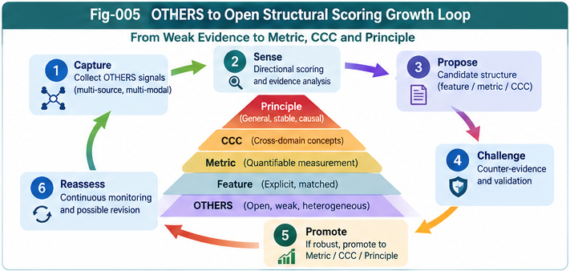

# BM-006 — From OTHERS to Open Structural Scoring Growth

**Beyond Matching: OTHERS, Directional Weak-Evidence Scoring, and Reputational Intelligence**  
**Authors:** Sizhe Tan & GPT-Obot  
**Version:** 1.0.0 — October 2026  
**Status:** Conceptual and algorithmic research proposal; not experimentally validated

## Abstract

Conventional scoring systems often begin with predefined features, metrics, and evaluation dimensions. Yet intelligent agents routinely encounter signals that are consequential without being sufficiently understood, aligned, or formalized. We call this residual and evolving evidence space **OTHERS**. Prior papers in this series distinguish formal matching, perspective-dependent assessment, directional weak-evidence scoring, and subjective action selection. This paper addresses the next question: **How can useful signals initially represented in OTHERS become explicit, testable, reusable structural knowledge?**

We propose **Open Structural Scoring Growth (OSSG)**: a governed learning cycle that captures heterogeneous evidence, measures its directional effects, discovers candidate features and relations, tests them against counter-evidence and distribution shifts, promotes validated candidates into structural representations, and preserves unexplained residuals for further inquiry. The proposal connects Directional Measurement Sails (DMS) to Metric Differential Trees (MDT), CCC, Principle Intelligence, PIRP/PIRU, collective learning, and SSI without conflating evidence, perspective, and authority. We specify candidate contracts, promotion criteria, failure modes, falsifiable hypotheses, and an experimental roadmap. The central claim is a research hypothesis, not a demonstrated performance result: **a scoring architecture that can discover and revise its own evaluation dimensions may adapt better than one confined to a fixed feature schema, provided that growth is controlled by evidence and governance.**

**Keywords:** OTHERS; open evidence space; structural scoring growth; weak evidence; directional measurement sails; feature discovery; counter-evidence; open-world learning; metric differential tree; principle intelligence; collective structural learning; subjective structural intelligence.

---

## 1. The Problem: A Scoring System Cannot Predefine Everything That Matters

A conventional scoring pipeline commonly assumes:

1. The relevant variables are known.
2. Observations can be mapped into those variables.
3. A distance, similarity, ranking, or utility function can be evaluated over that representation.
4. The feature schema remains sufficiently stable for deployment.

These assumptions are useful for closed and well-characterized tasks. They become fragile when environments change, domains do not share a stable ontology, indirect evidence matters, or previously negligible factors become decisive.

**OTHERS** is not a license to add arbitrary impressions to a score. It is an explicit holding space for observations whose meaning, reliability, or relationship to the current evaluation schema remains incomplete. Its contents may include contextual, relational, reputational, prospective, anomalous, and perspective-conditioned signals. Each observation must retain provenance and uncertainty.

A fixed scoring model may learn new weights while remaining blind to a missing evaluation dimension. OSSG targets this *representation-level* limitation: the system should be able to propose new features, metrics, relations, and scoring directions, subject to validation.

### 1.1 Four different kinds of change

| Change | Example | Required capability |
|---|---|---|
| Parameter adaptation | A known risk factor becomes more predictive | Update weights |
| Feature discovery | A previously ignored behavior predicts failure | Introduce a feature |
| Relation discovery | Two known variables matter only jointly | Introduce a relation or interaction |
| Perspective discovery | A new stakeholder needs a different criterion | Propose a new evaluation direction and request authorization |

The fourth case must not silently transfer decision authority from a human or governing institution to an adaptive scoring model.

## 2. Definitions and Scope

Let an observation event at time $t$ be $e_t$, the explicit structural knowledge base be $K_t$, and the current evaluation perspective be $P_t$. Define the operational residual evidence set:

$$
O_t = \{e \in E_{\le t}: e\text{ is not adequately explained or represented by }K_t\}.
$$

This definition is *relative to a representation and an adequacy criterion*. OTHERS is not a metaphysical category of inherently unmeasurable phenomena. A signal can move from OTHERS into explicit knowledge, return to OTHERS after failed validation, or remain unresolved indefinitely.

We distinguish:

- **Evidence unit:** a source-linked observation, including missingness and uncertainty.
- **Directional response:** the estimated effect of an evidence unit on an explicitly identified scoring direction.
- **Candidate structure:** a hypothesized feature, relation, metric, rule, CCC, or principle.
- **Validated structure:** a candidate satisfying predeclared evidence and governance criteria for a specified scope.
- **Residual evidence:** observations not sufficiently explained after promotion.
- **Perspective contract:** the authorized meaning, scope, and direction of an evaluation.

**Structural growth** is the addition, revision, subdivision, recombination, or retirement of such representations—not merely a rise in a model's numerical score.

## 3. The Canonical Growth Loop

The proposed cycle is:

$$
\boxed{O_t}
\xrightarrow{\text{directional sensing}}
R_t
\xrightarrow{\text{pattern discovery}}
H_t
\xrightarrow{\text{counter-evidence + validation}}
K_{t+1}
\xrightarrow{\text{residual analysis}}
O_{t+1}.
$$

Here $R_t$ denotes direction-conditioned responses, $H_t$ candidate hypotheses, and $K_{t+1}$ the revised explicit structural store. The arrows are *process stages*, not guaranteed transformations: a stage may abstain, reject a candidate, or return it for further evidence collection.



*Fig-005. OTHERS-to-structure loop: provisional directional effects are challenged and validated before promotion into explicit features, metrics, CCCs, or principles.*

---

### 3.1 Six operational stages

1. **Capture:** Record weak and heterogeneous evidence without prematurely forcing it into the current feature schema.
2. **Sense:** Estimate its effect on existing directional sails, including uncertainty and disagreement.
3. **Propose:** Generate candidate features, interactions, new sails, or structural relations that might explain repeated responses.
4. **Challenge:** Search for counterexamples, correlated sources, confounders, alternative explanations, and distribution shifts.
5. **Promote:** Admit only sufficiently supported structures into an explicit, versioned knowledge representation.
6. **Reassess:** Monitor promoted structures; demote or revise them when their predictive, explanatory, or decision value deteriorates.

The loop is open-ended in the sense that the schema can change. It is not unconstrained: growth should be limited by evidence, computational budgets, safety requirements, and authorized policy.

## 4. Directional Measurement Sails as Discovery Sensors

A Directional Measurement Sail (DMS) is a response function associated with a particular evaluation direction $u_k$. For evidence units $e_i$, a simple candidate score is:

$$
R_k(x,t)=\sum_{i\in I(x,t)} w_{ik}(t)\,q_i(t)\,g_k(e_i,u_k),
$$

where $w_{ik}$ denotes influence, $q_i$ source quality, and $g_k$ a direction-specific response. This expression is a **baseline proposal**, not a calibrated probability or a metric. Correlated sources cannot generally be handled by simple independent summation.

A more robust representation preserves a structured output:

$$
\mathcal{R}_k(x,t)=\bigl(\widehat r_k,\;\mathcal U_k,\;n_{\mathrm{eff},k},\;\Pi_k,\;A_k\bigr),
$$

where $\mathcal U_k$ is uncertainty, $n_{\mathrm{eff},k}$ an estimate of effective independent evidence, $\Pi_k$ provenance, and $A_k$ an abstention or alert state.

### 4.1 From directional effects to new structure

Suppose an unfamiliar operational signal repeatedly predicts a failure mode, even though the current metric set does not contain it. DMS can flag the directional effect. Candidate discovery then asks:

- Does the signal retain value after controlling for existing metrics?
- Is the apparent effect explained by repeated reports from one source?
- Is the relation causal, predictive, or merely coincidental?
- Does it generalize to a different site, population, or time period?
- Can a stable and interpretable feature or relation be extracted?

**A sail is a detector of candidate relevance, not proof of a principle.**

## 5. Candidate Structural Representations

A candidate should have a typed representation rather than a free-text assertion alone. We propose the following abstract contract:

```yaml
candidate_id: H-0001
candidate_type: feature | relation | metric | ccc | principle | sail
claim: "Operational statement with a falsifiable prediction"
source_evidence_ids: [E-001, E-002]
perspective_id: P-001
applicable_scope:
  domain: "declared domain"
  population: "declared population"
  time_window: "declared interval"
expected_direction: positive | negative | mixed | unknown
baseline_comparator: "Existing metric or model"
counter_evidence_ids: []
validation_protocol: "Predeclared evaluation procedure"
status: proposed
owner_or_authority: "Authorized reviewer or policy"
version: "0.1"
```

This is an illustrative schema, not an implemented API. Actual deployments need privacy controls, access policy, source authentication, and lifecycle versioning.

### 5.1 Promotion targets

A validated candidate may become:

- **Feature:** a stable measurable attribute.
- **Metric:** a specified comparison or evaluation function, with stated mathematical properties.
- **CCC:** a reusable context/condition/consequence or decision-relevant structural unit, as defined in the associated SI framework.
- **Principle:** a broader relation supported across an explicitly tested scope; not an unqualified universal law.
- **Sail:** a new authorized direction of evaluation.
- **PIRP/PIRU:** a portable representation or runtime unit under its own compatibility contract.

Promotion is not necessarily a linear ladder. Different types can coexist, and a candidate may be useful as a scoped predictive feature without warranting elevation to a general principle.

## 6. Validation, Counter-Evidence, and Promotion Gates

A proposed structure should not be promoted merely because it correlates with a favorable outcome in the data used to discover it.

### 6.1 Minimum validation gates

| Gate | Question | Possible outcome |
|---|---|---|
| G1: Traceability | Can the underlying observations be located and audited? | Reject or quarantine if not |
| G2: Independence | Are multiple signals actually derived from the same source? | Down-weight or regroup |
| G3: Incremental value | Does the candidate improve over a predeclared baseline? | Retain as hypothesis if not |
| G4: Generalization | Does the effect persist outside discovery data? | Narrow scope or reject |
| G5: Robustness | Does it survive plausible perturbations and adversarial reports? | Restrict or reject |
| G6: Governance | Is the intended use permitted and the decision authority clear? | Block deployment if not |

### 6.2 A promotion rule

Let $\Delta V(H)$ be estimated out-of-sample incremental value, $C(H)$ implementation and maintenance cost, and $\rho(H)$ an uncertainty or risk penalty. One possible policy is:

$$
operatorname{Promote}(H)=1
\quad\text{only if}\quad
operatorname{LCB}_{1-\alpha}[\Delta V(H)]-C(H)-\rho(H)>\tau
$$

*and* all mandatory provenance, safety, and authority gates pass. This rule is illustrative: the lower confidence bound, penalty, and threshold must be defined for the task. For high-stakes uses, statistical evidence alone is insufficient for deployment approval.

### 6.3 Demotion and expiry

Every promoted item should specify a revalidation schedule, monitoring signals, and rollback procedure. Structural growth includes forgetting or retiring invalid structures. Otherwise the system accumulates obsolete metrics and becomes increasingly brittle.

## 7. The Residual Principle: OTHERS Never Disappears by Definition

After a candidate $H_t$ is validated and integrated, the system should not simply subtract all supporting observations from OTHERS. The residual is better expressed operationally as:

$$
O_{t+1}=operatorname{Residual}(E_{\le t+1},K_{t+1},\epsilon,P_{t+1}),
$$

where $\epsilon$ is an adequacy tolerance. Previously understood evidence can become residual again if context changes or an explanation fails.

This gives three forms of openness:

1. **Evidence openness:** previously unseen evidence types can enter.
2. **Representation openness:** new features and relations can be proposed.
3. **Evaluation openness:** new scoring directions can be proposed, but only authorized perspectives become operative.

The architecture must also support **abstention** when evidence is too weak to justify an estimate.

## 8. Per-Node Structural Intelligence and MDT Integration

In an SI implementation, an MDT node may represent a localized context, contrast, or decision region. OSSG can operate per node rather than forcing every signal into a single global scoring model.

A possible per-node package contains:

```text
NodeScoringContext
├── ExplicitMetrics
├── DirectionalSails
├── OTHERS_EvidenceBuffer
├── CandidateHypotheses
├── CounterEvidenceIndex
├── ProvenanceAndUncertainty
├── PromotionAndRollbackPolicy
└── ParentChildDeltaLinks
```

**Local-first growth** can reduce the risk of overgeneralizing a weak effect from one domain to all domains. A candidate discovered at a node can be tested at parent, sibling, or adjacent nodes before broader promotion. Differential representations help distinguish a genuinely new relation from a duplicate of existing structure.

Potential benefits are hypotheses: better localization, more auditable updates, and reduced interference. Costs include fragmented evidence, duplicated hypotheses, and governance complexity.

## 9. Principle Intelligence, CCC, and Structural Abstraction

Directional scoring can discover *where* a pattern may exist; abstraction asks *what* reusable relationship it expresses.

Consider the illustrative progression:

```text
Unexpected weak signal
  -> repeated directional association
  -> candidate interaction or condition
  -> scoped counter-evidence tests
  -> reusable CCC or metric
  -> cross-context principle candidate
  -> wider validation or rejection
```

A recurring association does not automatically imply causality. Principle claims require explicit statements of assumptions, mechanisms when available, and boundaries of applicability. Counter-evidence should be retained as part of the representation, not deleted when a hypothesis is promoted.

This connects to **Open Structural Learning**: new knowledge may emerge from sparse differential evidence, but the learning system must keep track of what has actually been demonstrated.

## 10. Collective Structural Learning and PIRP/PIRU Exchange

Multiple agents or BrainUnits may observe distinct parts of a problem. They can exchange evidence summaries, candidate structures, and validation results without waiting for a universally accepted metric.

A portable exchange packet might include:

```text
EvidenceOrCandidatePacket
├── SchemaAndVersion
├── OriginAndProvenance
├── DomainAndPerspectiveScope
├── DirectionalResponseWithUncertainty
├── SourceDependenceSummary
├── CandidateStructure
├── SupportingAndCounterEvidence
├── ValidationStatus
├── UsageAndPrivacyPolicy
└── CompatibilityAndExpiry
```

PIRP/PIRU provides a conceptual path for transporting such units, while localization and relay matching determine whether a packet is applicable in the receiving context. **Collective agreement is not independent validation**: common upstream data, correlated incentives, and shared model errors can make many agents wrong in the same direction.

## 11. SSI and the Separation of Three Planes

OSSG must preserve three different operations:

| Plane | Responsibility | Must not silently do |
|---|---|---|
| Evidence | Estimate what signals support, contradict, or leave uncertain | Rewrite evidence to favor a preferred action |
| Perspective | Specify which differences matter under an authorized context | Invent authority or universalize a local preference |
| Decision | Select or recommend actions given goals, costs, risks, and constraints | Treat an uncertain score as a guaranteed fact |

The interface to **Subjective Structural Intelligence (SSI)** should carry a perspective contract, decision owner, authorized objective, constraints, and audit trail. OSSG may propose a new sail; SSI and governance determine whether that sail is relevant and permissible for a given decision.

A crucial design rule follows: **evidence can improve a decision without owning the decision.**

## 12. A Worked Hypothetical Example: Supplier Reliability

Suppose a procurement system evaluates suppliers with known metrics: delivery punctuality, defect rate, and price. It also receives weak signals: informal reports of staff turnover, unusual response delays, and changing subcontractor patterns.

**Stage A — Baseline:** A fixed metric model ranks Supplier X highly.

**Stage B — OTHERS capture:** New observations are recorded with dates, sources, and reliability indicators. Unverified reports are marked as such.

**Stage C — Sail response:** A *continuity risk* sail registers a rising concern, but does not automatically change the supplier's factual defect rate.

**Stage D — Candidate discovery:** Repeated observations suggest a candidate relation between response-delay volatility and later delivery disruptions.

**Stage E — Challenge:** Investigators test whether the signal adds value beyond existing punctuality measures, whether sources are independent, and whether the association holds across suppliers and time periods.

**Stage F — Promotion or rejection:** If it generalizes and passes governance checks, a scoped volatility feature is added to the explicit scoring schema. If not, the hypothesis remains unvalidated or is retired.

**Stage G — SSI decision:** A procurement authority weighs verified risk, switching cost, urgency, and strategic priorities before choosing an action.

This is a thought experiment, not a reported empirical result. It illustrates why **weak-signal detection, evidence validation, and authorized choice** must remain distinct.

## 13. Research Hypotheses and Experimental Design

### 13.1 Falsifiable hypotheses

- **H1 — Incremental signal value:** Directional weak-evidence features improve out-of-distribution prediction or ranking over matched-feature baselines on some open-world tasks.
- **H2 — Growth over static schemas:** Controlled feature and relation discovery outperforms weight-only adaptation under specified domain shifts.
- **H3 — Provenance matters:** Correlation-aware aggregation reduces overconfidence relative to naive report counting.
- **H4 — Localization matters:** Per-node candidate promotion reduces negative transfer compared with indiscriminate global promotion.
- **H5 — Governance matters:** Promotion gates and rollback reduce harmful false promotions without eliminating most useful discoveries.
- **H6 — Discoverable sails:** Learning new scoring directions provides incremental value beyond tuning existing sails when the task genuinely contains an omitted objective or risk dimension.

### 13.2 Comparison systems

| System | Explicit metrics | Weak signals | Structural discovery | Governance |
|---|---:|---:|---:|---:|
| A: Static matching | Yes | No | No | Baseline |
| B: Context-enhanced | Yes | Limited | No | Baseline |
| C: DMS-only | Yes | Yes | No | Provenance controls |
| D: OSSG | Yes | Yes | Yes | Promotion/rollback |
| E: OSSG + SSI | Yes | Yes | Yes | Authorized perspective and choice |

### 13.3 Metrics and safeguards

Measure predictive accuracy, ranking quality, calibration, abstention quality, out-of-distribution performance, incremental utility, false-promotion rate, time to discover a useful feature, rollback latency, compute cost, and robustness to injected false reports.

Use temporal holdouts, domain-separated evaluation, predeclared baselines, source-grouped splitting, ablations of provenance and counter-evidence, and confidence intervals. Keep evidence discovery data separate from final confirmation data to reduce selection bias. When comparing action policies, report decision utility separately from prediction accuracy.

**Negative results matter:** if a static context-aware baseline matches OSSG after accounting for complexity, the added structural machinery is not justified for that task.

## 14. Failure Modes and Anti-Goodhart Protections

1. **Noise promotion:** spurious patterns become permanent metrics.
2. **Echo-chamber amplification:** repeated rumors appear as independent evidence.
3. **Perspective contamination:** a decision preference masquerades as a factual signal.
4. **Unbounded schema growth:** too many weak features degrade interpretability and reliability.
5. **Self-confirming loops:** deployed scores alter behavior and then appear validated by the resulting data.
6. **Distribution-shift blindness:** locally valid features are exported without scope checks.
7. **Adversarial steering:** an attacker plants directional signals to manipulate a sail.
8. **Authority creep:** a learned scoring direction silently becomes a policy objective.

Mitigations include source lineage, dependence modeling, challenge sets, shadow evaluation, independent review, complexity penalties, scope-limited promotion, drift monitoring, expiration, and rollback. No single safeguard is sufficient.

## 15. Relationship to Prior Work

The proposal intersects established areas including feature engineering and representation learning, novelty and anomaly detection, concept drift, active learning, Bayesian evidence aggregation, multi-criteria decision analysis, weak-signal management, reputation systems, continual learning, and causal discovery.

Relevant starting points include:

- Ansoff, H. I. (1975). *Managing Strategic Surprise by Response to Weak Signals*. California Management Review, 18(2), 21–33.
- Granovetter, M. S. (1973). *The Strength of Weak Ties*. American Journal of Sociology, 78(6), 1360–1380.
- Jøsang, A., Ismail, R., & Boyd, C. (2007). *A Survey of Trust and Reputation Systems for Online Service Provision*. Decision Support Systems, 43(2), 618–644.
- Gama, J., Žliobaitė, I., Bifet, A., Pechenizkiy, M., & Bouchachia, A. (2014). *A Survey on Concept Drift Adaptation*. ACM Computing Surveys, 46(4), Article 44.
- Parisi, G. I., Kemker, R., Part, J. L., Kanan, C., & Wermter, S. (2019). *Continual Lifelong Learning with Neural Networks: A Review*. Neural Networks, 113, 54–71.

These references establish neighboring research traditions; they do not validate OSSG. The possible contribution of this paper is the **explicit interface among residual evidence, directional scoring, candidate structural promotion, counter-evidence, and governed subject-specific choice**. Novelty claims require a deeper systematic literature review and empirical comparisons.

## 16. Open Questions

1. What is the most useful operational adequacy test for assigning a signal to OTHERS?
2. How can new sails be discovered without confusing an observed correlation with an authorized objective?
3. Which candidate structures should be local, shared, or globally promoted?
4. Can uncertainty be calibrated when evidence units are heterogeneous and highly dependent?
5. How should provenance and privacy be preserved during collective exchange?
6. When is a candidate sufficiently stable to become a Principle rather than a scoped heuristic?
7. How can promotion criteria avoid rewarding the model for inventing increasingly complex but unhelpful features?
8. Which parts of OSSG should be learned, which should be specified by contract, and which require human approval?

## 17. Conclusion

The neglected OTHERS term can be treated as more than a miscellaneous correction to a similarity formula. It can become an **open, evidence-governed discovery interface** between present scoring capabilities and future structural knowledge. Directional Measurement Sails provide one candidate mechanism for sensing potentially useful effects before a complete feature ontology exists. OSSG then asks whether those effects can be explained, challenged, validated, and converted into reusable structures.

The most important separation is between **noticing a signal**, **establishing a warranted claim**, and **choosing an action**. An open scoring system should support all three without collapsing them into one opaque score. Its success must be demonstrated by controlled comparisons, not presumed from architectural elegance.

> **What cannot yet be formally matched may still be directionally investigated; what proves reliable may become structure; what remains uncertain must remain contestable.**

---

## Repository Notes

- **Series:** Beyond Matching: OTHERS, Directional Weak-Evidence Scoring, and Reputational Intelligence.
- **Previous paper:** `BM-005-Perspective-Distance-and-Competitive-Action-Scoring.md`.
- **Next paper:** `BM-007-Counter-Evidence-Provenance-and-Scoring-Governance.md`.
- **License:** See repository `LICENSE` (Apache-2.0).
