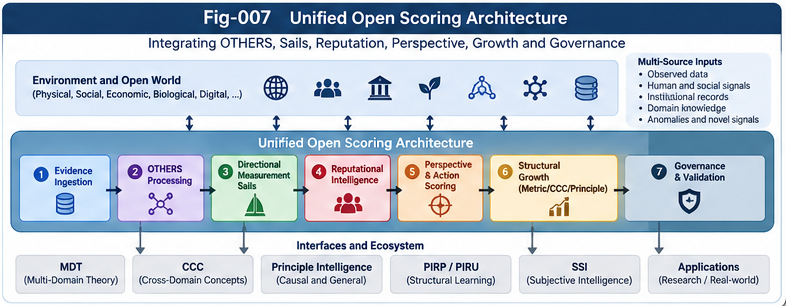

# BM-008 — Unified Architecture, Research Agenda, and Validation

**Project:** Beyond Matching: OTHERS, Directional Weak-Evidence Scoring, and Reputational Intelligence  
**Authors:** Sizhe Tan & GPT-Obot  
**Version:** 1.0.0 — October 16, 2026  
**Status:** Foundational research synthesis and proposed validation program; no experimental performance claims  
**Companion papers:** BM-001 through BM-007

## Abstract

An intelligent evaluator cannot assume that all consequential evidence has already been mapped into a shared feature space. Across unfamiliar domains, evidence may be contextual, relational, reputational, prospective, incomplete, dependent, or otherwise insufficiently formalized. The **Beyond Matching** research program introduces **OTHERS** as a governed, open evidence interface; **Directional Measurement Sails (DMS)** as candidate functions for measuring the directional implications of heterogeneous signals; and **Open Structural Scoring Growth (OSSG)** as a proposed mechanism for converting repeatedly useful signals into explicit, testable representations. This concluding paper integrates seven companion studies into a unified architecture and a staged research agenda. It specifies contracts between evidence, perspective, decision, and governance; identifies the distinction between mathematical distance and action value; formulates testable hypotheses and baselines; proposes benchmark families, metrics, ablations, and statistical safeguards; and clarifies connections to Structural Intelligence (SI), Subjective Structural Intelligence (SSI), Metric Differential Trees (MDT), CCC, Principle Intelligence, PIRP/PIRU, and Collective Structural Learning. The contribution is a **research architecture**, not an empirical demonstration that weak-evidence scoring is universally superior to existing methods.

**Keywords:** beyond matching; OTHERS; weak evidence; directional measurement sails; reputational intelligence; perspective distance; open structural scoring growth; counter-evidence; provenance; subjective structural intelligence; cross-domain evaluation.

---



---

## 1. The Research Problem and Its Boundaries

Many scoring systems start with a representation and then compute similarity, distance, or ranking. This is effective when the representation contains the variables relevant to the task. The problem arises when consequential signals remain outside the current schema: the model may be numerically precise about the *wrong set of variables*. This is a hypothesis about a failure mode, not a claim that AI is generally inferior to human cross-domain reasoning.

The program asks five questions:

1. **Coverage:** What happens when important evidence is not expressible in the current matching schema?
2. **Direction:** Can incomplete evidence nevertheless provide calibrated support or opposition to a specific evaluative direction?
3. **Growth:** Can validated weak signals become new features, relations, metrics, CCC structures, or principles?
4. **Collectivity:** Can signals be exchanged across individuals or BrainUnits without double-counting, losing context, or laundering rumor into fact?
5. **Authority:** Who defines the perspective, goals, acceptable risk, and permission to act?

The proposal does not treat all unmatched signals as informative. OTHERS includes noise, artifacts, manipulation, and missing information; these require rejection or abstention rather than forced interpretation.

## 2. Canonical Concepts and Terminology

| Concept | Definition | Boundary |
|---|---|---|
| Formal matching | Comparison on aligned, declared features | Does not imply decision relevance |
| Metric distance | A function satisfying non-negativity, identity, symmetry, and triangle inequality | Not every dissimilarity is a metric |
| Similarity-derived dissimilarity | A transformation such as `1 - similarity` for normalized similarity | Not automatically a metric or action cost |
| Perspective distance | A contextual, potentially asymmetric relational assessment | Must declare perspective and semantics |
| OTHERS | Residual evidence not adequately represented by the active matching schema | Not a claim of truth or usefulness |
| OEU | OTHERS Evidence Unit with provenance and uncertainty | Raw evidence record, not a decision |
| DMS | Directional Measurement Sail: an evaluative response function | Requires direction, scope, and calibration |
| Reputation field | Multiple source-dependent, direction-dependent reputation signals | Repetition is not independence |
| OSSG | Governed process for proposing and validating new scoring structures | Promotion requires evidence and rollback |
| SSI | Explicit treatment of subject, perspective, goals, and choice authority | Must not overwrite evidence provenance |

The term **distance** is retained only when its mathematical or operational meaning is specified. For action selection, *cost*, *risk*, *value*, or *preference score* is often more precise.

## 3. Unified Architecture

The reference architecture comprises seven connected subsystems:

```text
[Observed objects, events, behavior, reports, contexts]
                         |
                         v
       +--------------------------------+
       | Evidence Ingestion and OEU     |
       | provenance, time, uncertainty  |
       +--------------------------------+
                    /           \
                   v             v
        [Matched Features]   [OTHERS Residuals]
                   \             /
                    v           v
          +-----------------------------+
          | Directional Measurement     |
          | Sails (DMS)                 |
          | dependency / uncertainty    |
          +-----------------------------+
                         |
                         v
          +-----------------------------+
          | Perspective Interpretation  |
          | perspective contract, scope |
          +-----------------------------+
                         |
                         v
          +-----------------------------+
          | Decision / SSI Interface    |
          | goals, utility, authority   |
          +-----------------------------+
                         |
                         v
                 [Action or Abstain]
                         |
                  outcomes / feedback
                         v
          +-----------------------------+
          | OSSG Candidate Discovery    |
          | challenge / validate /      |
          | promote / rollback          |
          +-----------------------------+
                         |
              validated structure updates
                         v
               [Feature / CCC / MDT /
                Principle / PIRP-PIRU]

  Governance, counter-evidence, and audit span every subsystem.
```

**Figure placement:** Insert `../figures/Fig-007-Unified-Open-Scoring-Architecture.png` immediately after this architecture. See also Fig-001 for the grand map and Fig-006 for the three-plane separation.

### 3.1 Contracts between subsystems

An OEU should declare at minimum `evidence_id`, `claim_or_observation`, `source`, `observed_at`, `context`, `lineage`, `reliability_assessment`, `uncertainty`, `access_policy`, and `counter_evidence_links`. A sail contract should declare `direction_id`, `interpretation`, `scope`, `response_function`, `calibration_version`, `dependency_policy`, and `abstention_policy`. A perspective contract should declare `principal`, `task`, `context`, `horizon`, and `permitted transformations`. A decision contract should declare `authorized chooser`, `objectives`, `constraints`, `risk tolerance`, `action space`, and `audit requirements`.

These are proposed logical interfaces, not finalized wire protocols. Each interface must be versioned, and downstream consumers must be able to reject incompatible or underspecified records.

## 4. Mathematical Skeleton

### 4.1 From matched features to open evidence

For objects or states \(x,y\), perspective \(P\), and context \(C\):

$$
S(x,y\mid P,C)=F(E_{xy},M_{xy},O_{xy};P,C).
$$

Here \(E_{xy}\) and \(M_{xy}\) represent declared matched components, while \(O_{xy}\) contains relevant *candidate* residual signals. The function \(F\) must specify output semantics; it may produce a vector, distribution, partial order, or abstention rather than a scalar.

### 4.2 Directional response

For a direction \(k\), a simple illustrative sail is

$$
R_k(x)=\sum_{i=1}^{n} w_i q_i\,g_k(v_i,u_k),
$$

where \(v_i\) represents signal \(i\), \(u_k\) is the declared direction, \(w_i\) is an aggregation weight, \(q_i\) is an evidence-quality factor, and \(g_k\) is the response function. This equation is **not** a validated estimator. Naive addition fails under correlated reports; practical designs must use dependency-aware aggregation, uncertainty propagation, calibration, and potentially non-additive models.

A robust output can be represented as

$$
\mathcal{R}_k=(\widehat r_k,\,\mathcal U_k,\,Q_k,\,\mathcal P_k),
$$

with estimated directional effect, uncertainty, quality, and provenance respectively. The evaluator may abstain when uncertainty or source dependence is too high.

### 4.3 Perspective and action are not interchangeable

A contextual perspective score may be asymmetric:

$$
D_P(x\rightarrow y\mid C)\ne D_P(y\rightarrow x\mid C).
$$

This is not necessarily a mathematical metric. Downstream action selection should instead optimize an explicitly authorized objective, for example

$$
a^*=\arg\max_{a\in\mathcal A_{\mathrm{allowed}}}
\mathbb E[U(a,\omega)\mid E,O,P,C,G].
$$

Evidence constraints must remain separate from the chooser's utility function. Competitive advantage may change an action threshold; it must not authorize falsifying the evidence estimate.

### 4.4 Growth as a governed transition

$$
O_t\xrightarrow{\mathrm{sense}}H_t
\xrightarrow{\mathrm{challenge+validate}}K_{t+1},
$$

where \(H_t\) is a candidate feature, relation, sail, or principle, and \(K_{t+1}\) is a promoted structural representation. Failed and unresolved hypotheses remain contestable; a residual \(O_{t+1}\) remains open.

## 5. End-to-End Processing Lifecycle

1. **Capture:** Record raw observations and source metadata; preserve original evidence where permitted.
2. **Classify:** Separate matched evidence, candidate OTHERS, duplicates, and uninterpretable signals.
3. **Sense:** Apply declared DMS directions; emit estimates, uncertainty, provenance, and abstentions.
4. **Interpret:** Apply a versioned perspective contract; disclose transformations and missing coverage.
5. **Decide:** Evaluate options under authorized goals, constraints, and action limits.
6. **Observe:** Collect outcomes, delayed labels, failures, and counter-evidence without post-hoc rewriting of earlier records.
7. **Grow:** Generate structural candidates from stable residual patterns; validate on held-out and shifted conditions.
8. **Govern:** Promote, quarantine, revise, or roll back candidates; retain audit trails.

A system can stop at any stage. The existence of OTHERS does not imply that every signal must influence a decision.

## 6. Relationship to the Seven Companion Papers

| Paper | Principal contribution | Role in unified system |
|---|---|---|
| BM-001 | Limits of matching and distance scoring | Problem formulation and mathematical distinctions |
| BM-002 | OTHERS as an open evidence space | Input ontology and OEU concept |
| BM-003 | Directional Measurement Sails | Directional scoring proposal |
| BM-004 | Reputational and collective weak signals | Social and distributed evidence mechanisms |
| BM-005 | Perspective distance and competitive action scoring | Contextual interpretation and SSI boundary |
| BM-006 | Open Structural Scoring Growth | Candidate discovery, validation, and promotion |
| BM-007 | Counter-evidence, provenance, and governance | Trust, audit, authorization, and reversibility |
| BM-008 | Synthesis and validation roadmap | Integration, hypotheses, experiments, and milestones |

The papers are modular: an evaluator may use OTHERS without social reputation, DMS without automated growth, or OSSG with a non-DMS candidate generator. No module should be presented as a prerequisite unless experimentally justified.

## 7. Interfaces to the Broader SI / SSI Ecosystem

**MDT:** Residual signals and learned directions may be attached to context-specific nodes, with per-node evidence coverage, evaluation contracts, and localized scoring functions. The tree is a possible indexing and growth substrate, not a guarantee of correctness.

**CCC:** Repeated directional patterns may be proposed as reusable context–condition–consequence or other explicitly defined CCC structures. Promotion requires independent evidence and counter-examples.

**Principle Intelligence:** A generalized principle is a stronger claim than a useful local heuristic. Cross-context stability and falsification attempts are necessary before abstraction.

**PIRP/PIRU:** Portable evidence and scoring structures require declared context, provenance, compatibility, and authority. Transfer must not strip caveats or convert local confidence into global certainty.

**Collective Structural Learning:** Multiple BrainUnits may exchange candidate directions, evidence summaries, and failures. Provenance graphs and independence checks prevent social amplification from masquerading as corroboration.

**SSI:** Subject identity, goal ownership, risk preferences, and action authority are explicit downstream inputs. The system must distinguish *whose evidence*, *whose perspective*, *whose utility*, and *whose choice*.

**Policy Control Plane:** Controls govern admission, privacy, allowed use, promotion, execution, appeals, and rollback. Strong governance is especially important when scores affect people or institutions.

## 8. Prior Research and Novelty Boundaries

The proposal builds on established work rather than claiming first discovery of weak signals or contextual decisions. Relevant research includes:

- Multi-criteria decision analysis, including outranking methods such as ELECTRE and PROMETHEE, which explicitly handle heterogeneous criteria, thresholds, and non-compensatory preferences.
- Strategic weak-signal analysis, including H. Igor Ansoff's work on early warning and strategic surprise.
- Social network and reputation research, including Granovetter's work on weak ties and computational trust/reputation models.
- Bayesian evidence integration, robust decision-making, signal detection theory, uncertainty quantification, and calibration.
- Representation learning, open-world recognition, concept discovery, continual learning, and human/AI preference learning.
- Causal inference and data provenance, particularly where correlated sources and feedback loops make naive aggregation unreliable.

The candidate contribution is **an integrated open interface and governed growth loop** connecting residual evidence, direction-specific scoring, perspective contracts, and structural promotion. Whether this combination is novel relative to specific prior architectures, and whether it improves measurable outcomes, remain open research questions requiring systematic literature review and experiments.

## 9. Research Hypotheses

**H1 — Coverage:** Adding well-curated OTHERS evidence improves task-relevant coverage over matched-feature baselines on some pre-registered open-world tasks.

**H2 — Directionality:** Multi-directional DMS outputs outperform a single reputation scalar for tasks with conflicting evaluation objectives.

**H3 — Dependence:** Provenance- and dependency-aware aggregation reduces overconfidence under correlated or repeated reports compared with naive independent-signal addition.

**H4 — Calibration:** Explicit uncertainty and abstention improve selective risk without unacceptable loss of useful coverage.

**H5 — Growth:** Governed OSSG promotion produces more stable out-of-distribution performance than unconstrained feature expansion in selected dynamic environments.

**H6 — Choice separation:** Explicit SSI and policy contracts reduce unauthorized or preference-contaminated decisions compared with systems that merge evidence and utility in one opaque score.

**H7 — Collective exchange:** Portable weak-signal structures improve multi-agent learning efficiency when provenance and context are preserved, relative to exchanging only scalar scores.

**H8 — Limits:** Under noisy, manipulated, or irrelevant residual signals, OTHERS-enabled systems may perform worse than matched-only baselines; detection and abstention should reduce but may not eliminate the damage.

These hypotheses are conditional and falsifiable. Null or negative results are scientifically informative.

## 10. Experimental Design: Benchmark Families

### 10.1 Cross-domain analogy and evaluation

Use tasks in which feature overlap is deliberately low but relational or functional correspondence can be assessed with independently specified ground truth. Compare domain-held-out performance and avoid training/test contamination. Distinguish factual analogical accuracy from downstream decision utility.

### 10.2 Early warning under sparse evidence

Construct temporally ordered tasks such as synthetic equipment failure, simulated supplier disruption, or publicly documented historical warning sequences. Only evidence available *before* the outcome may be used. Evaluate lead time, false alarms, precision–recall, and calibrated uncertainty.

### 10.3 Reputation and collective signals

Generate or curate evidence graphs with original reports, re-posts, independent corroboration, and adversarial manipulation. Include contradictory evidence and explicit source lineage. Evaluate both ranking accuracy and confidence under dependence shifts.

### 10.4 Perspective and competitive decision tasks

Use identical evidence with multiple authorized goals and asymmetric loss matrices. Measure whether evidence estimates remain stable while optimal actions vary appropriately by declared perspective and utility. Include forbidden actions and permission checks.

### 10.5 Open-ended structural growth

Use environments with emerging features, concept drift, hidden subgroups, and delayed labels. Measure candidate generation, promotion precision, rollback behavior, complexity growth, and retained performance after distribution shift.

## 11. Baselines, Ablations, and Evaluation Metrics

### 11.1 Primary comparison systems

| ID | System | Purpose |
|---|---|---|
| A | Matched features only | Minimal reference baseline |
| B | Matched features + declared context | Tests contextual value |
| C | B + raw OTHERS pooled without direction | Tests benefit of residual evidence alone |
| D | B + DMS with fixed sails | Tests directionality |
| E | D + provenance and dependence control | Tests evidence governance |
| F | E + OSSG with promotion gates | Tests structural growth |
| G | F + SSI perspective and action contracts | Tests explicit subject and decision separation |

Where appropriate, include strong task-specific baselines: calibrated supervised models, probabilistic graphical models, retrieval-augmented models, MCDA outranking methods, causal or temporal models, and modern foundation-model evaluators. A weak baseline would not support meaningful claims of improvement.

### 11.2 Required ablations

- Remove OTHERS entirely; retain context.
- Shuffle weak-signal directions while preserving signal counts.
- Remove source-dependence correction.
- Replace multidirectional outputs with one scalar.
- Disable counter-evidence and rollback.
- Disable candidate promotion; keep fixed sails.
- Allow uncontrolled promotion as a stress-test comparator.
- Remove SSI contracts while holding evidence constant.
- Inject adversarial or duplicated reports at graded rates.

### 11.3 Metrics

| Dimension | Suggested measures |
|---|---|
| Prediction/ranking | AUROC, AUPRC, ranking correlation, top-k precision, task accuracy |
| Calibration | Brier score, log loss, reliability curves, calibration error |
| Abstention | Risk–coverage curves, selective error |
| Warning | Lead time, false alarm rate, missed event rate |
| Decisions | Expected utility, regret, constraint violation rate |
| Robustness | Performance under shift, adversarial degradation, duplication sensitivity |
| Growth | Promotion precision, rollback rate, stability, complexity per unit gain |
| Governance | Provenance completeness, unauthorized-action rate, audit reproducibility |
| Collective learning | Sample efficiency, transfer gains, double-counting rate |

Report uncertainty intervals, data coverage, computational cost, and failure cases. Do not combine incompatible metrics into an unexplained single success score.

## 12. Experimental Protocol and Statistical Safeguards

1. Pre-register the task, primary metric, hypotheses, exclusions, and intended analysis before viewing final test results.
2. Partition by time, source network, domain, and entity where needed to avoid leakage.
3. Maintain an untouched test set and a separate stress-test set for adversarial and shifted conditions.
4. Annotate ground truth with documented procedures and inter-annotator disagreement where human labels are used.
5. Evaluate strong baselines under comparable budgets, data access, and tuning effort.
6. Use paired comparisons and confidence intervals; correct or disclose multiplicity across many endpoints.
7. Track model and sail versions, prompts, data lineage, random seeds, and computational budgets.
8. Conduct subgroup and privacy assessments before any deployment affecting individuals.
9. Publish null results, adverse cases, and failed promotion attempts alongside positive findings.
10. Keep retrospective historical examples distinct from prospective validation.

Where human evaluation is needed, avoid using an AI model's own unverified judgments as the sole ground truth for that same model's scoring quality.

## 13. A Worked Experimental Scenario: Supplier Disruption

Suppose two candidate suppliers have similar formal quality metrics. Additional signals include staff departures, shipment delays, social reports, and unusual communication patterns. Some reports originate from one repeated source; others are independent.

**Matched-only:** compares declared cost, quality, and delivery metrics.

**OTHERS ingestion:** records time-stamped observations with provenance and uncertainty; rumors are not promoted to facts.

**DMS:** evaluates reliability, disruption risk, and opportunity as distinct directions. Conflicting evidence remains visible.

**Perspective:** a short-horizon buyer and a long-horizon strategic partner may interpret the same directional outputs differently.

**Decision:** authorized policies select actions based on risk tolerance, contractual obligations, and alternatives. A low-confidence score may trigger investigation rather than supplier exclusion.

**OSSG:** if a previously overlooked operational pattern repeatedly predicts verified disruption across held-out suppliers, the system proposes a candidate feature; validation and governance determine promotion.

This scenario is illustrative only. No numerical result or operational superiority is claimed.

## 14. Governance, Safety, and Failure Containment

Open evidence systems must be designed to resist the conversion of uncertainty into authority. Key safeguards include:

- **Provenance first:** distinguish observation, hearsay, inference, and generated summary.
- **Dependency control:** repeated transmission does not create independent confirmation.
- **Counter-evidence:** maintain explicit contradiction links and revision history.
- **Calibration and abstention:** prefer acknowledged uncertainty to false precision.
- **Purpose limitation:** reputation evidence must not be silently repurposed across contexts.
- **Human and institutional authority:** high-stakes actions require explicit permission and appropriate oversight.
- **Privacy and fairness:** exclude or constrain sensitive, irrelevant, and unlawfully collected signals; evaluate disparate impacts.
- **Promotion gates:** no candidate becomes authoritative merely because it improved one benchmark.
- **Rollback:** detect drift, regressions, and harmful incentives; retain recoverable prior versions.

This architecture does not itself establish legal compliance, fairness, safety, or epistemic truth. Those properties require domain-specific evaluation and governance.

## 15. Research Roadmap and Milestones

### Phase I — Foundation (v1.0.0)

**Deliverables:** BM-001–BM-008; shared terminology; architecture diagrams; formal interface proposals; hypothesis registry; experimental blueprint.  
**Exit criterion:** internal conceptual consistency and an explicit separation of proposals from evidence.

### Phase II — Controlled Validation (candidate v1.1.0)

**Deliverables:** at least two benchmark families, strong baselines, provenance-aware DMS prototype, calibration and ablation reports, reproducible experiment manifests.  
**Exit criterion:** transparent evidence for where the method helps, does not help, or fails.

### Phase III — Structural Growth (candidate v2.0.0)

**Deliverables:** candidate feature discovery, promotion and rollback protocols, per-node MDT integration, portable structure contracts, and controlled multi-agent transfer tests.  
**Exit criterion:** demonstrated stability under change, not merely growth in the number of features.

### Phase IV — Applied and Governed Systems (future)

**Deliverables:** domain-specific deployment studies, authorization checks, audit tools, human oversight, and longitudinal monitoring.  
**Exit criterion:** domain-appropriate evidence of reliability and acceptable risk.

Version labels are planning targets, not release commitments.

## 16. Open Questions

1. Can OTHERS be defined operationally without becoming an unlimited category for arbitrary features?
2. How should a sail be discovered when its direction is not known in advance?
3. Can directional effects be estimated without embedding hidden preference judgments into evidence scoring?
4. Which dependence models are sufficient for reputation cascades and coordinated manipulation?
5. When is a weak signal informative enough to influence action, and when should the system abstain?
6. What constitutes a valid promotion from local heuristic to transferable CCC or Principle?
7. How should uncertainty and provenance survive PIRP/PIRU transfer across BrainUnits?
8. Can a system discover useful new evaluation axes without Goodhart-driven proliferation?
9. Which failures arise from missing evidence, misinterpreted evidence, and conflicting objectives respectively?
10. How should human oversight and SSI choice authority interact in collective intelligence?
11. What are the computational and energy costs relative to simpler alternatives?
12. Which negative results would falsify the practical value of DMS or OSSG for a given domain?

## 17. Recommended Figure Placement Across the Series

| Figure | File | Primary location |
|---|---|---|
| Fig-001 | `Fig-001-Beyond-Matching-Grand-Map.png` | BM-002, overview of evidence space |
| Fig-002 | `Fig-002-Matching-vs-Perspective-Distance.png` | BM-001, distinction between score types |
| Fig-003 | `Fig-003-Directional-Measurement-Sails.png` | BM-003, sail algorithm |
| Fig-004 | `Fig-004-Reputational-Collective-Signals.png` | BM-004, collective evidence |
| Fig-005 | `Fig-005-OTHERS-Structural-Growth-Loop.png` | BM-006, growth loop |
| Fig-006 | `Fig-006-Evidence-Perspective-Decision-Planes.png` | BM-005 / BM-007, decision and governance |
| Fig-007 | `Fig-007-Unified-Open-Scoring-Architecture.png` | BM-008, Section 3 |

Figure names are proposed publication assets; diagrams are not experimental evidence.

## 18. Conclusion

The central lesson of the Beyond Matching program is not that formal metrics are obsolete. Formal matching remains indispensable when its representation fits the problem. The proposed extension is to make **unrepresented but potentially consequential evidence visible, directional, contestable, and learnable** rather than silently discarding it or treating it as truth.

OTHERS provides the open evidence interface. DMS proposes a directional sensing mechanism. Reputational intelligence supplies one important family of indirect and collective signals. OSSG proposes a governed route from weak signals to explicit structural knowledge. SSI and the Policy Control Plane establish the boundary between evidence, perspective, and authorized choice.

The decisive next step is empirical: **demonstrate where these mechanisms add calibrated value over strong existing methods, where they fail, and which controls prevent weak evidence from becoming unjustified authority.**

> **Beyond Matching is not beyond evidence. It is a proposal to make the boundaries of present evidence models explicit—and to learn across those boundaries without abandoning rigor.**

## References and Research Anchors

The following are orientation references, not an exhaustive or systematically verified novelty review. Bibliographic details should be checked against primary publications before formal scholarly submission.

1. Ansoff, H. I. (1975). *Managing Strategic Surprise by Response to Weak Signals*. California Management Review, 18(2), 21–33.
2. Granovetter, M. S. (1973). *The Strength of Weak Ties*. American Journal of Sociology, 78(6), 1360–1380.
3. Roy, B. (1991). *The Outranking Approach and the Foundations of ELECTRE Methods*. Theory and Decision, 31, 49–73.
4. Brans, J.-P., and Vincke, P. (1985). *A Preference Ranking Organisation Method*. Management Science, 31(6), 647–656.
5. Jøsang, A., Ismail, R., and Boyd, C. (2007). *A Survey of Trust and Reputation Systems for Online Service Provision*. Decision Support Systems, 43(2), 618–644.
6. Goodhart, C. A. E. (1975). *Problems of Monetary Management: The U.K. Experience*. Papers in Monetary Economics, Reserve Bank of Australia.
7. Pearl, J. (2009). *Causality: Models, Reasoning, and Inference* (2nd ed.). Cambridge University Press.
8. Dawid, A. P. (1982). *The Well-Calibrated Bayesian*. Journal of the American Statistical Association, 77(379), 605–610.

## Repository Notes

- **Location:** `docs/BM-008-Unified-Architecture-Research-Agenda-and-Validation.md`
- **Primary illustration:** `figures/Fig-007-Unified-Open-Scoring-Architecture.png` after Section 3.
- **Cross-references:** BM-001–BM-007; `FIGURE-INDEX.md`; `FUTURE-DIRECTIONS.md`.
- **Release status:** v1.0.0 foundational research proposal; no implementation or benchmark results implied.
- **License:** Follow repository-level `LICENSE` (planned Apache-2.0).
