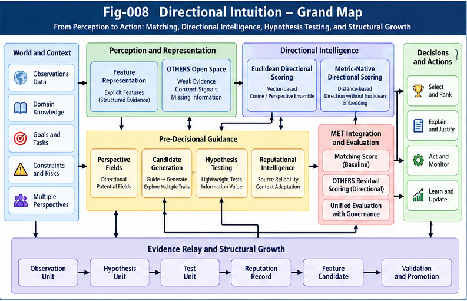
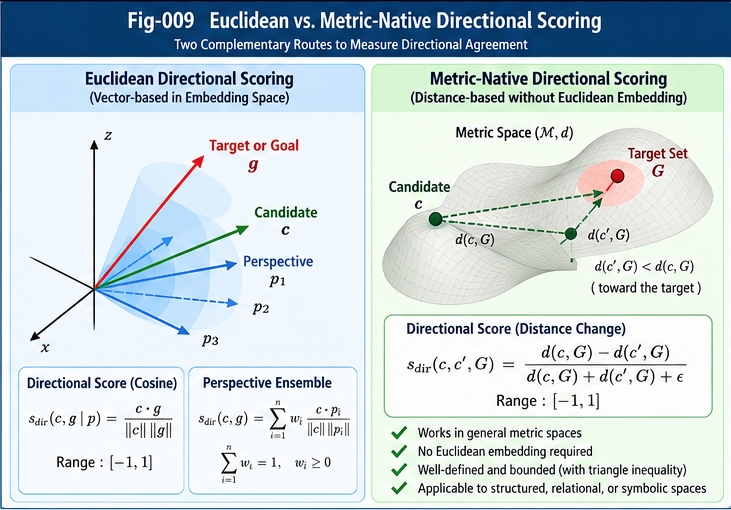

# MDI-001 — Problem Definition and Research Boundaries

**Research extension:** Metric Directional Intuition (MDI)  
**Parent framework:** Beyond Matching: OTHERS, Directional Weak-Evidence Scoring, and Reputational Intelligence (BM-ODWEI)  
**Status:** Theory-first research proposal; mathematical definitions and testable hypotheses, not a validated biological model  
**Intended repository path:** `extensions/metric-directional-intuition/docs/MDI-001-Problem-Definition-and-Research-Boundaries.md`

## Abstract

Conventional structural similarity systems primarily assess what can be aligned, matched, or measured through an established representation. Yet potentially consequential evidence can remain outside reliable matching: unaligned components, context-dependent tendencies, directional cues, and weak observations. This paper defines the problem of **perspective-conditioned directional intuition** as an extension to structural matching, not a replacement for it. It separates structural similarity, directional utility, directional agreement, evidence reliability, and distance-like ranking scores; specifies Euclidean and metric-native research routes; and introduces a representation-agnostic directional scoring contract. It also identifies the boundaries between proven mathematical properties, engineering hypotheses, and claims about animal or human intuition. The objective is to create a falsifiable research interface through which OTHERS evidence can be scored, challenged, calibrated, relayed, and eventually promoted into reliable structural matching capabilities.

---

**Figure 008. Directional Intuition — Grand Map.** Conceptual integration of matching evidence, the OTHERS open-evidence space, perspective-conditioned directional scoring, pre-decisional guidance, hypothesis testing, reputational evaluation, MET integration, and evidence-driven structural growth. Arrows indicate proposed information and control relationships rather than proven causal or neural mechanisms.

---

**Figure 009. Euclidean vs. Metric-Native Directional Scoring.** The Euclidean route evaluates alignment through normalized vector projections; the metric-native route evaluates progress toward a goal set using changes in a distance-to-goal potential. The latter does not require a Euclidean embedding, provided the metric and goal set satisfy the stated assumptions.

---

## 1. Motivation and Relationship to BM-ODWEI

BM-ODWEI proposes a research trajectory:

> Matching → OTHERS → Directional Measurement Sails → Reputational Intelligence → Structural Growth → Evidence Governance.

The MDI extension develops the mathematical and experimental implications of that trajectory. **OTHERS** denotes evidence not yet adequately represented by a reliable matching scheme; it does not imply that the evidence is irrelevant, false, or intrinsically unmeasurable. **Directional Measurement Sails** offer one family of provisional evaluation mechanisms. **Reputational Intelligence** and evidence governance determine whether such provisional contributions deserve trust over time.

MDI adds three distinct research questions:

1. Can perspective-conditioned weak evidence improve similarity-based ranking or decisions beyond a matching-only baseline?
2. Can directional evaluations be computed directly in metric or structural spaces, without mandatory Euclidean embedding?
3. Can low-cost hypothesis testing and evidence relay turn initially weak directional judgments into calibrated, reusable structural knowledge?

These are research questions, not established performance claims.

## 2. Problem Setting

Let `A` be a reference structure, `B` a candidate structure, `P` a perspective (subject, goal, task, values, and relevant constraints), and `E` an evidence state with provenance. Let `M` denote the representation and comparison model, potentially including a metric space `(X,d)`, a structured graph, a state-transition relation, or an embedding.

A matching baseline produces

$$
S_M(A,B\mid M)\in[0,1].
$$

An MDI operator produces a directional evaluation, together with confidence or reliability metadata and supporting evidence:

$$
operatorname{DirectionalEvaluate}(A,B,P,M,E)
\longrightarrow (s,c,\pi),
$$

where `s` is a bounded directional score, `c` is a separately defined reliability or calibration quantity, and `π` is a provenance/explanation record. A combined scoring policy may subsequently calculate

$$
S_I(A,B\mid P,M,E)\in[0,1],\qquad
D_I(A,B\mid P,M,E)=1-S_I(A,B\mid P,M,E).
$$

**Important:** `D_I` is a normalized *distance score*. It is not necessarily a mathematical metric: identity of indiscernibles, symmetry, and the triangle inequality are not guaranteed. Perspective-conditioned directional utility can be asymmetric by design.

### 2.1 Five quantities that must not be conflated

| Quantity | Question answered | Typical range |
|---|---|---|
| Matching similarity `S_M(A,B)` | How well do A and B match under an established representation? | `[0,1]` |
| Directional utility `U_P(B)` | Does B point toward a desirable direction under P? | Often `[-1,1]` or `[0,1]` |
| Directional agreement `G_P(A,B)` | Are A and B similarly oriented under P? | `[0,1]` |
| Evidence reliability `R(E,P)` | How well supported or calibrated is the directional estimate? | Context-dependent; often `[0,1]` |
| Combined score `S_I` | What ranking or decision score results from a declared policy? | `[0,1]` |

High utility does not imply high agreement; high agreement does not imply that either structure is desirable. Reliability is not automatically the probability that a hypothesis is true.

## 3. Perspective and Directionality

A perspective is an explicit, versioned specification of evaluation conditions: relevant objectives, observer or subject assumptions, trade-offs, permissible evidence, constraints, and time horizon. It may be represented by:

- a single Euclidean direction vector;
- a weighted ensemble of direction vectors;
- a state-dependent vector field;
- a target set or value function over a metric space; or
- a learned, possibly non-potential, relation over state transitions.

These are candidate representations, not claims that all such structures are mathematically equivalent. In particular, a metric specifies distances but **does not by itself determine which direction is good**. A goal, ordering, value, or other perspective-dependent orientation is additionally required.

### 3.1 Pre-decisional directionality

MDI distinguishes two roles of directional information:

1. **Forward guidance:** bias attention, evidence collection, hypothesis generation, or candidate search before explicit scoring.
2. **Directional scoring:** evaluate an already proposed structure, state transition, or action.

A directional representation may participate in both roles and be updated by observed outcomes. The proposition that such representations contribute to human or animal intuition is a *biomimetic hypothesis* requiring independent evidence, not a conclusion from the engineering model.

## 4. Initial Mathematical Routes

### 4.1 Euclidean directional sail (V1)

For nonzero feature vectors `v_i` and nonzero perspective vector `p`, a weighted signed projection is

$$
C_P(B)=\frac{\sum_{i\in I}q_i\,\cos(v_i,p)}{\sum_{i\in I}q_i},
\qquad q_i\ge0,\quad\sum_{i\in I}q_i>0.
$$

Thus `C_P(B) ∈ [-1,1]`. One bounded mapping is `U_P(B)=(1+C_P(B))/2`. The neutral midpoint `0.5` must **not** be interpreted as 50% evidential support. Missing or invalid directional evidence is reported explicitly, not silently imputed as an observation.

### 4.2 Metric-native directional difference (V2)

Let `(X,d)` be a metric space and `G_P` a nonempty target subset such that distances to the set are finite. Define

$$
V_P(x)=d(x,G_P)=\inf_{g\in G_P}d(x,g).
$$

For distinct `x,y` define

$$
C_P(x,y)=\frac{V_P(x)-V_P(y)}{d(x,y)}.
$$

The distance-to-set function is 1-Lipschitz:

$$
|V_P(x)-V_P(y)|\le d(x,y).
$$

Therefore

$$
\boxed{-1\le C_P(x,y)\le 1.}
$$

This result requires **no Euclidean embedding and no cosine calculation**. Positive scores indicate decreasing distance to the target set; negative scores indicate increasing distance; zero indicates no net change in target distance. At `x=y`, the ratio is undefined and must be handled by an explicit contract (e.g., not-applicable). In general, this score evaluates a **transition** from `x` to `y`; it is not automatically a symmetric similarity between two structures.

In differentiable Euclidean settings, with `y=x+h` and `h` small, the numerator is approximately `-∇V_P(x)·h`, giving a local directional-derivative interpretation. This approximation requires differentiability and should not be generalized to arbitrary metric spaces.

### 4.3 Learned transition preference (V3)

A broader candidate is a bounded relation `Φ_P(x,y) ∈ [-1,1]`, learned or specified from evidence. It need not arise from a global potential function and may encode context-dependent or cyclic preferences. Such flexibility increases expressive power but complicates calibration, consistency, safety, and governance. V3 may use V1 or V2 as suboperators; the routes are not asserted to be mutually exclusive or strictly nested.

## 5. Combining Matching and Directional Evidence

A bounded baseline mixture is

$$
S_I=(1-\lambda)S_M+\lambda S_P,\qquad
0\le\lambda\le1,\quad S_P\in[0,1].
$$

This guarantees `[0,1]` outputs but can shift a strong matching score merely because a neutral directional score is supplied. An alternative is a residual correction:

$$
S_I=operatorname{clip}_{[0,1]}(S_M+\eta g_P C_{\mathrm{OTHERS}}),
$$

where `η ≥ 0` is a correction budget, `g_P ∈ [0,1]` is a declared evidence-validity/reliability gate, and `C_OTHERS ∈ [-1,1]` is a signed contribution from evidence not already credited to matching. When no usable directional evidence exists, set `g_P=0`, yielding `S_I=S_M`.

A logit-space alternative can avoid hard clipping for interior baseline scores:

$$
S_I=\sigma\!\left(operatorname{logit}(S_M)+\eta g_P C_{\mathrm{OTHERS}}\right),\quad 0<S_M<1.
$$

None of these aggregation rules is claimed to be optimal. The choice must be tested for ranking quality, calibration, stability, and evidence double counting. A common additive term can be dropped for *ranking under fixed conditions* but not for preserving absolute calibrated scores.

## 6. OTHERS and Evidence Allocation

The MDI extension adopts a conservative evidence-accounting rule: an observation already credited to matching must not be counted again as independent directional evidence without an explicit dependency model.

One possible soft allocation assigns each evidence element `i` a matching-explanation weight `r_i ∈ [0,1]` and directional residual weight `q_i^O=q_i(1-r_i)`. This is a proposed bookkeeping mechanism, not proof of statistical independence. Provenance, feature overlap, and information leakage still require audit.

The intended growth pathway is:

$$
\text{Unmatched/Weak Evidence}
\rightarrow\text{Directional Hypothesis}
\rightarrow\text{Tested Evidence}
\rightarrow\text{Validated Feature}
\rightarrow\text{Matching Capability}.
$$

Promotion must be reversible if counter-evidence emerges. Failed or ambiguous hypotheses should remain available for future reassessment, with their limits recorded.

## 7. Lightweight Hypothesis Testing and Reputation

A perspective may guide the selection of a small number of high-value hypotheses rather than requiring exhaustive modeling. For a candidate action `a`, a local prediction `ŷ=T_local(x,a)` may be evaluated by a directional operator; subsequent observations update the credibility of the prediction source and its domain of applicability.

A Beta–Bernoulli update provides one deliberately narrow example for exchangeable binary outcomes:

$$
\mathbb E[\theta\mid s,f]=\frac{\alpha+s}{\alpha+\beta+s+f},
\quad\alpha,\beta>0.
$$

Here `s` and `f` count consistently defined successes and failures. The posterior mean is not a general-purpose reliability score for correlated, nonstationary, continuous, or selectively sampled evidence. More elaborate models must be evaluated where those assumptions fail.

Hypothesis selection can consider expected decision value or expected value of information relative to observation cost. Whether this reproduces biological intuition remains an open empirical question.

## 8. Minimal Directional Scoring Contract

A future interoperable implementation should at minimum specify:

**Inputs**
- Reference and candidate structures, or a source/target state transition.
- Perspective identifier, version, objective/target representation, and constraints.
- Metric or structural representation identifier and its validity assumptions.
- Evidence identifiers, provenance, timestamps, and matching-overlap declarations.
- Operator selection, aggregation policy, and computation budget.

**Outputs**
- Operator type and signed directional contribution, if applicable.
- Bounded similarity/ranking score, if aggregation is requested.
- Evidence status: valid, missing, insufficient, incompatible, or not applicable.
- Reliability/calibration estimate with explicit semantics and uncertainty.
- Contribution breakdown, counter-evidence, provenance, and reproducibility metadata.

**Invariants and safeguards**
- Preserve declared output ranges; reject invalid zero-vector or zero-denominator operations.
- Do not confuse a distance score with a mathematical metric.
- Do not silently treat missing evidence as neutral observed evidence.
- Keep perspective and policy versions explicit.
- Maintain a matching-only fallback when directional evidence is unavailable.
- Support counter-evidence, correction, and audit of repeated evidence use.
- Enforce domain-specific constraints before any safety-critical action.

This is a conceptual contract; a machine-readable schema and conformance suite belong to later MDI work.

## 9. Validation Questions and Baselines

A minimum experimental program compares:

- **E0:** Matching-only baseline.
- **E1:** Euclidean directional sail.
- **E2:** Metric-native directional difference.
- **E3:** OTHERS-aware residual scoring with reliability governance.
- **E4:** Lightweight hypothesis-guided evidence acquisition and relay.

Metrics should include task-dependent ranking or decision quality, calibration, out-of-distribution generalization, sample efficiency, runtime cost, and robustness to adversarial or misleading evidence. Necessary controls include random-perspective ablations, matched-parameter baselines, evidence-leakage audits, and comparisons with established embedding similarity, learned ranking, Bayesian decision, and planning approaches.

A change in ranking alone is **not** evidence of improvement. Biomimetic claims require separate behavioral or neuroscientific comparisons rather than inference from engineering performance.

## 10. Research Boundaries and Non-Claims

1. **No biological identification:** The proposed formulas do not establish how human or animal brains compute intuition.
2. **No universal Euclidean assumption:** Vector embeddings are one engineering route, not a required ontology.
3. **No metric guarantee for combined scores:** `1 − similarity` need not obey metric axioms.
4. **No intrinsic direction from distance alone:** A perspective, goal, preference, or orientation is essential.
5. **No evidence of superiority yet:** Improvement over existing algorithms is an empirical question.
6. **No confidence-by-convention:** Reliability must be defined, measured, and calibrated for a particular task and data regime.
7. **No automatic safety guarantee:** Bounded scores and provenance do not establish safe behavior.
8. **No forced closure of OTHERS:** Unknown, contested, and negative evidence must remain representable.

## 11. Relationship to the MDI Series

- **MDI-002:** Euclidean and metric-native directional operators, mathematical properties, and edge cases.
- **MDI-003:** Perspective fields, forward guidance, and pre-decisional directional hypotheses.
- **MDI-004:** OTHERS residual scoring, MET integration, and aggregation contracts.
- **MDI-005:** Lightweight hypothesis testing, reputation, and evidence-budgeted inference.
- **MDI-006:** Evidence relay, validation, structural growth, and cross-framework interfaces.

This paper establishes terminology and research boundaries; it does not replace BM-001–BM-008. Those documents remain the parent framework's original theoretical record.

## 12. Conclusion

Metric Directional Intuition asks whether structural systems can evaluate meaningful directionality in evidence that conventional matching does not yet explain. Its initial contribution is a careful separation of matching, utility, agreement, reliability, and decision score, together with two computable directions: Euclidean cosine-based sails and metric-native target-distance differences. The latter yields a bounded signed directional score directly in a metric space under explicit assumptions. The longer-term research agenda is to determine when such operators improve decisions, how lightweight hypotheses and reputation can govern their use, and whether any of these engineering mechanisms illuminate biological intuition. The framework is intentionally open to correction, counter-evidence, alternative representations, and structural relay.

---

**Suggested citation context:** BM-ODWEI, Metric Directional Intuition research extension, MDI-001. Cite the parent repository's versioned release and DOI when available; do not substitute an unverified DOI.

**License:** Governed by the parent repository's `LICENSE.txt` (verify repository license before distribution).
