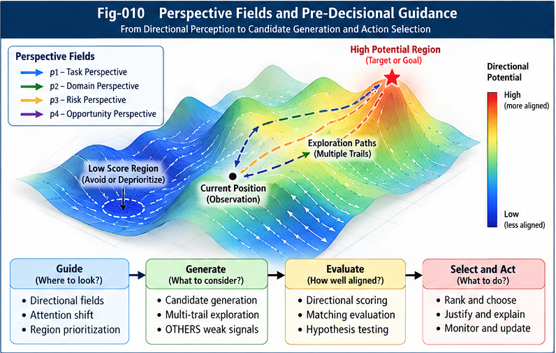
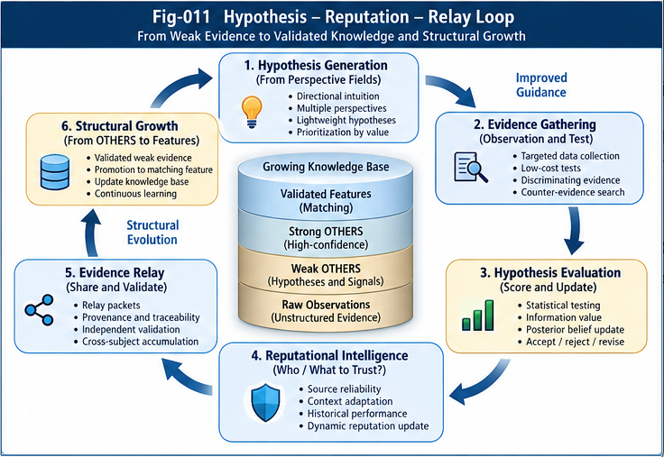

# MDI-005 — Lightweight Hypothesis Testing and Reputational Intelligence

**Series:** Metric-Directional Intuition (MDI), a research extension of *Beyond Matching: OTHERS and Directional Weak-Evidence Intelligence (BM-ODWEI)*  
**Status:** Research proposal / theory-first specification  
**Version target:** BM-ODWEI v1.1.0 (proposed)  
**Date:** 2026-10-27  
**Scope:** Low-cost directional hypothesis generation, discriminating evidence, reliability estimation, and governed decision support.  
**Dependencies:** MDI-001–004; especially MDI-002's metric-native directional operator and MDI-004's residual evidence allocation.

> **Central hypothesis.** An effective intuitive system need not evaluate every possibility exhaustively. It may instead generate a small portfolio of directionally relevant hypotheses, seek inexpensive discriminating evidence, and update context-sensitive reputations before acting or relaying what it learned. This is an engineering and cognitive-science hypothesis, not a claim about an established neural implementation.

## Abstract

This paper proposes **Lightweight Hypothesis-Guided Directional Intelligence (LHDI)** as a candidate mechanism connecting perspective-conditioned directional scoring with reputational weak-evidence learning. A system operating under limited time, observations, and computation constructs a small hypothesis portfolio; scores candidate tests by expected decision improvement relative to cost; updates beliefs and source reliabilities; and either acts, abstains, requests more evidence, or relays a bounded, auditable evidence object. The design distinguishes the probability that a hypothesis is true from the reliability of a source, the confidence of a score, and the utility of an action. It also separates a metric-native *potential-derived* directional score from a general learned pairwise relation, and makes OTHERS evidence accounting explicit. We give a minimal contract, mathematical examples, governance invariants, counterexamples, and a falsifiable validation program. No empirical performance or biological correspondence is asserted.

---

**Figure 010. Perspective Fields and Pre-Decisional Guidance.** Schematic perspective-conditioned landscape with multiple exploration trails. Directional information can prioritize attention and candidate generation before explicit evaluation, subject to task, risk, and governance constraints. The landscape is illustrative and does not require a Euclidean state representation.

---

**Figure 011. Hypothesis–Reputation–Relay Loop.** A proposed low-budget cycle in which directional hypotheses guide targeted evidence gathering, evaluation updates context-specific reliability, and provenance-preserving relay supports further testing. Promotion of OTHERS evidence into established matching features requires independent validation and governance rather than mere repetition.

---

## 1. Motivation and research question

BM-ODWEI distinguishes ordinary feature matching from **OTHERS**: evidence that is potentially informative but not yet captured by established matching features. MDI-002 develops direction-sensitive operators; MDI-003 explores pre-decisional guidance; and MDI-004 specifies residual scoring and integration into MET. A missing piece is **how to decide which weak signals deserve examination** when the candidate space is large and observation budgets are small.

Consider an animal hearing a rustle, a robot detecting an ambiguous obstacle, or a software agent seeing an anomalous tool result. The central task is not merely to assign a similarity score. It is to decide *which of a few plausible explanations is worth testing next*, and whether that test can change an action.

**Research question:** Can a small, perspective-guided portfolio of hypotheses, combined with cheap discriminating tests and reputation-aware evidence handling, achieve better decision quality per unit cost than unguided enumeration, uncalibrated heuristics, or matching-only scoring?

The term *intuitive* denotes the operational target—fast, selective, limited-budget inference—not proof of a particular biological mechanism.

## 2. Definitions and separation of quantities

Let \((\mathcal X,d)\) be a metric state space, \(x\in\mathcal X\) the current state, \(P\) a perspective (goal, risk policy, and relevant context), \(\mathcal A(x)\) a feasible action set, and \(E\) observed evidence. A hypothesis \(H_j\) is a testable proposition about the state, an action outcome, a causal explanation, or the validity of a directional relation. A test \(t\) yields an observation \(o\) with an associated cost.

Keep at least five quantities distinct:

1. **Belief** \(b_j=P(H_j\mid E,c)\): probability assigned to the hypothesis in context \(c\), under an explicitly stated model.
2. **Source reliability** \(r_s(c)\): how often source \(s\) provides appropriately calibrated or correct information in comparable contexts.
3. **Directional value** \(C_P(x,y)\): whether transition \(x\to y\) advances the perspective, according to a declared directional operator.
4. **Decision utility** \(U(a,H_j,P)\): consequences of taking action \(a\) if \(H_j\) is true or false.
5. **Evidence/score confidence**: an uncertainty descriptor for the estimation procedure; not interchangeable with any of the above.

A hypothesis may be highly probable but unimportant, while a low-probability hypothesis may be worth checking because its consequences are severe. Similarly, a reliable source can provide weak evidence on a specific occasion.

## 3. Directional hypotheses and the hypothesis portfolio

A **directional hypothesis** proposes a testable relation between a prospective transition and a perspective. Examples include:

- \(H_1\): moving toward region \(R\) reduces distance to a designated goal set;
- \(H_2\): an observed signal predicts a high-cost hazard;
- \(H_3\): a candidate structural feature, currently classified as OTHERS, improves prediction of outcomes;
- \(H_4\): a previously trusted source is unreliable under the current context shift.

Let \(\mathcal H_K=\{H_1,\ldots,H_K\}\) be a bounded portfolio, where \(K\) is limited by a computational budget. Candidate generation can use a direction field, metric potential, structural precedent, counterexample, or externally relayed evidence. It must not equate *high directional alignment* with *truth*.

A practical generation contract is:

`GenerateHypotheses(state, perspective, evidence, budget) -> ranked hypotheses with provenance and proposed discriminating tests`

Hypothesis diversity matters: selecting only mutually reinforcing hypotheses risks confirmation bias. At least one competing or null explanation should be considered when feasible.

## 4. Metric-native directional evidence

For a nonempty goal set \(G_P\subseteq\mathcal X\), define \(V_P(x)=d(x,G_P)=\inf_{g\in G_P}d(x,g)\). For \(x\neq y\), define

$$
C_P(x,y)=\frac{V_P(x)-V_P(y)}{d(x,y)}.
$$

Because distance to a set is 1-Lipschitz, \(|V_P(x)-V_P(y)|\le d(x,y)\), so \(C_P(x,y)\in[-1,1]\). For \(x=y\), the ratio is undefined and must be handled by an explicit no-transition policy rather than division by zero.

If an action \(a\) produces a predicted next state \(\hat y_a\), then \(\hat C_P(x,a)=C_P(x,\hat y_a)\) is a **model-conditioned prediction**, not an observed fact. The prediction model and its uncertainty must accompany the score.

A more general structural relation \(\Phi_P(x,y)\in[-1,1]\) may be learned directly and need not derive from any global potential. Such a relation can be asymmetric or nontransitive; its assumptions must be declared. Neither formulation implies that an animal's brain literally computes metric distances or Euclidean cosines.

## 5. Lightweight evidence tests

A test is useful when its possible outcomes distinguish hypotheses **and** can change the decision. For a finite set of hypotheses, let \(b(H)\) be the current belief distribution and \(p(o\mid H,t)\) the observation likelihood under test \(t\). Bayes' rule gives

$$
b(H\mid o,t)=\frac{p(o\mid H,t)b(H)}{\sum_{H'}p(o\mid H',t)b(H')}.
$$

A cheap test may inspect an additional sensor reading, sample a small neighborhood, query a trusted precedent, compare one counterexample, or request another agent's assessment. The mechanism should avoid exhaustive simulation when a smaller discriminating test suffices.

**Information gain** is one test criterion:

$$
operatorname{EIG}(t)=\mathcal H(b)-\mathbb E_{o\sim p(o\mid t)}[\mathcal H(b(\cdot\mid o,t))],
$$

where \(\mathcal H\) is entropy. However, information gain alone may prefer a scientifically interesting but decision-irrelevant test. The primary criterion for action guidance should be **expected value of sample information (EVSI)**:

$$
operatorname{EVSI}(t)=
\mathbb E_o\left[\max_a\mathbb E_{H\mid o,t}U(a,H,P)\right]
-\max_a\mathbb E_H U(a,H,P).
$$

The system should consider a test only when its estimated benefit justifies its observation, latency, and computation costs. With cost \(c(t)\), a simple myopic selection rule is

$$
t^*=\arg\max_{t\in\mathcal T}\{operatorname{EVSI}(t)-\lambda c(t)\},
$$

subject to hard safety, privacy, and resource constraints. The null option **do not test** must remain available. For approximate EVSI, report model assumptions and estimation uncertainty; an estimated positive value is not a guarantee of real-world benefit.

## 6. Reputation as context-sensitive evidence governance

Reputation is not a universal scalar that certifies truth. At minimum, distinguish:

- **Hypothesis track record:** prior predictive success under comparable tests;
- **Source reliability:** calibration and error patterns of a sensor, person, agent, or precedent;
- **Perspective applicability:** whether evidence transfers to the current goal and context;
- **Test reliability:** sensitivity, specificity, and known failure modes;
- **Provenance:** origin, timestamp, method, and dependence on other evidence.

For binary outcomes with conditionally exchangeable trials, a Beta-Bernoulli bookkeeping model gives

$$
\theta\sim operatorname{Beta}(\alpha,\beta),\qquad
\mathbb E[\theta\mid s,f]=\frac{\alpha+s}{\alpha+\beta+s+f},
$$

where \(s\) and \(f\) count clearly defined successes and failures. This is an inexpensive estimator of an event rate under assumptions of comparable trials; it is **not automatically** the posterior probability of an arbitrary hypothesis, nor does it account for nonstationarity or correlated observations.

For source observations, a likelihood-based approach is preferable when sensitivity and specificity are known:

$$
\frac{P(H\mid e)}{P(\neg H\mid e)}
=\frac{P(H)}{P(\neg H)}
\times\frac{P(e\mid H,s,c)}{P(e\mid\neg H,s,c)}.
$$

Here the likelihood ratio captures how informative a source's particular report is in context. Reusing the same evidence through multiple agents must not multiply its weight as though the reports were independent.

A heuristic such as \(r\,C_P\) may be used as an explicitly labeled *gated directional signal*, but should not be interpreted as a calibrated expected utility or probability without further assumptions.

## 7. Worked example: ambiguous environmental signal

Suppose a mobile agent hears a rustle. Its portfolio contains \(H_1\): hazardous source; \(H_2\): benign wind; and \(H_3\): harmless moving object. The agent has actions *proceed*, *inspect*, and *retreat*. Retreat has a cost, while proceeding under \(H_1\) has a much larger loss. A short inspection can produce evidence that discriminates \(H_1\) from the alternatives.

The correct next step depends on the prior beliefs, the observation model, test cost, and loss matrix. A low prior probability of danger may still justify inspection if the downside is large; a test that is accurate but too slow may be inappropriate. The agent should not simply choose the hypothesis with the largest cosine alignment, nor automatically retreat whenever any weak hazard signal appears.

This example is illustrative and makes no claim that animals use explicit Bayesian tables. It demonstrates why **directional attention**, **hypothesis truth**, **test selection**, and **action utility** must remain separate.

## 8. An illustrative numerical decision calculation

Consider two hypotheses, \(H\) (hazard) and \(\neg H\), with prior \(P(H)=0.10\). Action *proceed* yields utility \(-100\) under \(H\) and \(0\) otherwise; *retreat* yields \(-8\) regardless of state. Without a test, expected utility of proceeding is \(-10\), so retreat (\(-8\)) is preferred.

Suppose a test has sensitivity \(0.80\), specificity \(0.90\), and cost \(1\). The probability of a positive report is \(0.8(0.1)+0.1(0.9)=0.17\); the posterior hazard probability is \(0.08/0.17\approx0.4706\). After a negative report, hazard probability is \(0.02/0.83\approx0.0241\). Therefore, retreat after a positive report and proceed after a negative report. The expected utility *before* test cost is

$$
0.17(-8)+0.83\left(-100\frac{0.02}{0.83}\right)=-3.36.
$$

After test cost, utility is \(-4.36\). The EVSI is \(-3.36-(-8)=4.64\), and net benefit is \(3.64\). Thus the test is worth performing under the stated model. The numbers are invented solely to show the computation and are not empirical measurements.

## 9. Integrating OTHERS without double counting

MDI-004 requires a separation between established Matching evidence and residual OTHERS evidence. A directional hypothesis may originate from OTHERS, but its evidence must not be counted again when the same signal has already influenced a matching feature, a source reputation, or a related hypothesis.

An evidence ledger should assign every observation an immutable identity and record: source, acquisition method, feature coverage, perspective, transformation lineage, hypothesis associations, dependence group, and acceptance/rejection rationale. The scoring layer can then calculate a residual allocation weight \(w_i^{\mathrm{res}}\in[0,1]\) for signal \(i\), conditional on established coverage and dependence.

A generic, **nonprobabilistic** residual correction is

$$
S_{\mathrm{new}}=operatorname{clip}_{[0,1]}\bigl(S_M+\eta\,g\,\Delta_{\mathrm{OTHERS}}\bigr),
$$

where \(S_M\) is baseline matching similarity, \(g\) is a governance gate, and \(\Delta_{\mathrm{OTHERS}}\) is a signed, bounded correction derived from residual evidence. This score is not automatically calibrated; the gate is not a substitute for explicit dependence handling. If no admissible directional evidence exists, the adapter should return \(S_M\) unchanged, with a visible reason code.

## 10. Minimal system architecture

The proposed pipeline is:

1. **Observe:** obtain state, context, and weak evidence with provenance.
2. **Orient:** select perspective, hard constraints, and applicable directional representation.
3. **Generate:** construct a small, diverse hypothesis portfolio.
4. **Estimate:** evaluate directional relevance and current beliefs separately.
5. **Test:** choose a discriminating, budget-compliant observation using approximate decision value.
6. **Update:** revise beliefs and context-specific reputations, preserving counter-evidence.
7. **Decide:** act, abstain, escalate, or gather more evidence under the utility and safety policy.
8. **Relay:** emit a portable hypothesis/evidence/result object with explicit leftovers.
9. **Learn:** update source calibration and candidate structural features only after validation.

This pipeline is a candidate architecture, not a claim of universal optimality. In high-risk cases, hard constraints and escalation policies supersede heuristic directional rankings.

## 11. Contract sketch: hypothesis and test objects

The following are *semantic contract fields*, not a mandated serialization format.

**HypothesisUnit**

- `hypothesis_id`, `claim`, `context`, `perspective_id`, `candidate_origin`
- `belief_estimate`, `belief_method`, `uncertainty`, `applicability_scope`
- `directional_operator_id`, `predicted_transition`, `directional_score`
- `supporting_evidence_ids`, `counter_evidence_ids`, `dependency_groups`
- `proposed_tests`, `resource_estimate`, `safety_constraints`
- `status`: proposed / tested / provisionally supported / contradicted / unresolved / retired

**TestUnit**

- `test_id`, `target_hypotheses`, `observation_model`, `expected_discrimination`
- `estimated_EVSI`, `cost_model`, `risk`, `stopping_rule`
- `result`, `measurement_uncertainty`, `provenance`, `decision_impact`

**ReputationRecord**

- `entity_id`, `entity_type`, `context_scope`, `outcome_definition`
- `prior_model`, `update_method`, `support_count`, `failure_count`
- `calibration_summary`, `drift_indicators`, `evidence_lineage`, `validity_window`

**RelayPacket**

- `packet_id`, `source_units`, `hypothesis_state`, `test_results`
- `perspective`, `constraints`, `counter_evidence`, `open_residuals`
- `reproducibility_notes`, `receiving_context`, `nontransferable_assumptions`

A conforming consumer must be able to distinguish **unknown**, **not tested**, **test failed**, and **contradicted**. These statuses are not interchangeable.

## 12. Stopping rules and bounded computation

A lightweight design requires explicit budgets: maximum hypotheses \(K\), maximum tests \(T\), observation cost, latency, energy, and memory. Terminate testing when one of the following occurs:

- a decision is robust across plausible beliefs;
- estimated net EVSI is nonpositive or below a configured threshold;
- a hard budget or deadline is reached;
- a safety policy requires escalation or abstention;
- observations cease to provide sufficiently independent evidence.

A system must expose the stopping reason and remaining uncertainty. **Repeated execution is itself a form of relay** when it yields new outcome data, but repeated observations are not automatically independent new evidence.

## 13. Reputation drift, adversarial evidence, and governance

Failure modes include correlated witness amplification, reward hacking, fabricated tests, source collusion, stale reputations, distribution shift, confirmation bias, and overconfident directional models. Mitigations include:

- context-indexed reputations and drift checks;
- immutable provenance and evidence dependency graphs;
- explicit counter-hypotheses and negative controls;
- calibration audits and out-of-distribution abstention;
- caps on the influence of unverified OTHERS signals;
- separate decision authority and scoring authority;
- independent reevaluation before promoting a weak signal into a permanent Matching feature.

A high reputation should never override a hard safety constraint or erase disconfirming evidence.

## 14. Relationship to BM-ODWEI, MET, and the SI ecosystem

**BM-002 (OTHERS)** provides an open evidence reservoir; **BM-003 (Directional Sails)** motivates perspective-guided measurement; **BM-004 (Reputational Intelligence)** motivates source and hypothesis reliability; **BM-006 (Structural Growth)** motivates feature promotion; **BM-007 (Governance)** supplies counter-evidence and provenance discipline.

**MDI-002** supplies directional operators; **MDI-003** supplies pre-decisional guidance; **MDI-004** supplies residual accounting and a baseline-preserving MET adapter. This paper adds a *selection and learning loop* for deciding which hypotheses and tests to spend resources on. In a UIERU or broader SI architecture, HypothesisUnits and TestUnits may be relayed across agents and reused as structural precedents, subject to compatibility and provenance checks.

This extension does not revise BM-001–008 or require a change to the original MET matching semantics.

## 15. Conformance requirements

- **LHDI-CONF-01:** Declare the perspective and relevant decision utility or loss model.
- **LHDI-CONF-02:** Keep hypothesis belief, source reputation, directional score, and action utility separately typed.
- **LHDI-CONF-03:** Limit the hypothesis and test budgets explicitly.
- **LHDI-CONF-04:** Preserve at least one competing explanation or explain why none was generated.
- **LHDI-CONF-05:** State assumptions behind every likelihood, prior, and reputation update.
- **LHDI-CONF-06:** Do not count dependent evidence as independent without a justified model.
- **LHDI-CONF-07:** Attach evidence provenance, counter-evidence, and context scope.
- **LHDI-CONF-08:** Use decision value, not entropy reduction alone, when optimizing action-guiding tests.
- **LHDI-CONF-09:** Support a no-test, no-action, or escalation option when appropriate.
- **LHDI-CONF-10:** Preserve baseline MET scoring when admissible residual evidence is absent.
- **LHDI-CONF-11:** Expose uncertainty, stopping reason, and unresolved hypotheses.
- **LHDI-CONF-12:** Keep biological interpretation explicitly hypothetical.
- **LHDI-CONF-13:** Require validation before promoting OTHERS evidence to established features.
- **LHDI-CONF-14:** Retain transfer restrictions when relaying reputations across contexts.

## 16. Testable hypotheses and evaluation plan

**H1 — Budgeted decision quality.** Under fixed observation/computation budgets, directionally guided hypothesis portfolios improve realized utility over random and unguided portfolios on appropriately designed tasks.

**H2 — Test selection.** Approximate EVSI-based tests yield greater decision improvement per cost than selecting tests solely by entropy reduction, when test relevance to utility varies.

**H3 — Context-aware reputation.** Context-indexed reliability estimates outperform global success-rate estimates under controlled distribution shift.

**H4 — Dependence governance.** Evidence-lineage accounting reduces overconfidence relative to naive aggregation when multiple reports share a common source.

**H5 — Residual value.** OTHERS-only directional corrections add predictive or decision value beyond a matching-only baseline without measurable evidence leakage.

**H6 — Relay reuse.** Portable HypothesisUnits reduce repeated exploration cost across compatible tasks while preserving calibration and provenance.

**H7 — Metric-native comparison.** Metric-native directionality can equal or outperform Euclidean embedding-based directional heuristics on tasks whose meaningful transitions are poorly represented by a Euclidean embedding; this is a contingent empirical claim, not a theorem.

Recommended experimental conditions: matching-only; matching plus unguided OTHERS; Euclidean directionality; metric-native directionality; guided hypotheses without reputation; reputation without lineage governance; full LHDI; and random-perspective / shuffled-evidence controls. Report realized utility, calibration (e.g., Brier score), false-alarm and miss rates, cost, latency, hypothesis diversity, evidence overlap, OOD degradation, and abstention quality. Pre-register thresholds and evaluate across multiple seeds and task families.

## 17. Open questions and limitations

1. Which hypothesis representations remain useful without explicit metric geometry?
2. When should a directional hypothesis be treated as a testable causal claim rather than a correlation?
3. How can EVSI be approximated cheaply enough that the approximation does not consume the intended savings?
4. How should reputation transfer across perspectives, environments, and agents?
5. Can a system learn useful counter-hypotheses without creating an intractably large search space?
6. Which weak signals are worth promoting into stable Matching features, and how is rollback handled?
7. What behavioral evidence would distinguish this computational hypothesis from alternative cognitive mechanisms in animals?
8. How should the system handle adversarially manipulated observation costs and test results?

The principal limitations are dependence on a meaningful perspective, a defensible observation model, calibrated or bounded uncertainty, and context-appropriate utility assumptions. No general theorem establishes superior performance of this architecture; selective testing can fail if its hypothesis portfolio excludes the true explanation.

## 18. Research boundary and conclusion

This paper proposes a **small-compute hypothesis-and-reputation loop** as an extension of directional weak-evidence intelligence. Its mathematically grounded components include standard Bayesian updating, Beta-Bernoulli bookkeeping under stated assumptions, and the bounded metric-native potential-difference operator inherited from MDI-002. Its system architecture, efficiency benefits, and biomimetic interpretation remain hypotheses to test.

The essential design principle is:

> **Intuition may depend less on evaluating everything than on selecting a few consequential directional hypotheses and testing them with trustworthy, discriminating evidence.**

A reliable implementation must make the selection process inspectable: what was hypothesized, why it was worth testing, what evidence was obtained, which sources were trusted, what remains unknown, and how the result may be relayed without overstating its validity.

---

## Suggested reading and conceptual references

- BM-002 — *OTHERS as an Open Evidence Space*.
- BM-003 — *Directional Measurement Sails and Weak-Evidence Scoring*.
- BM-004 — *Reputational Intelligence and Collective Weak Signals*.
- BM-006 — *From OTHERS to Open Structural Scoring Growth*.
- BM-007 — *Counter-Evidence, Provenance, and Scoring Governance*.
- MDI-001–004 — preceding papers in this research extension.
- Bayesian decision theory; value of information; proper scoring rules and calibration; sequential testing; active perception; contextual reliability estimation. These are research traditions, not claims that the proposed integration has already been validated.

**Next paper:** MDI-006 — *Evidence Relay, Validation, and Structural Growth*.
